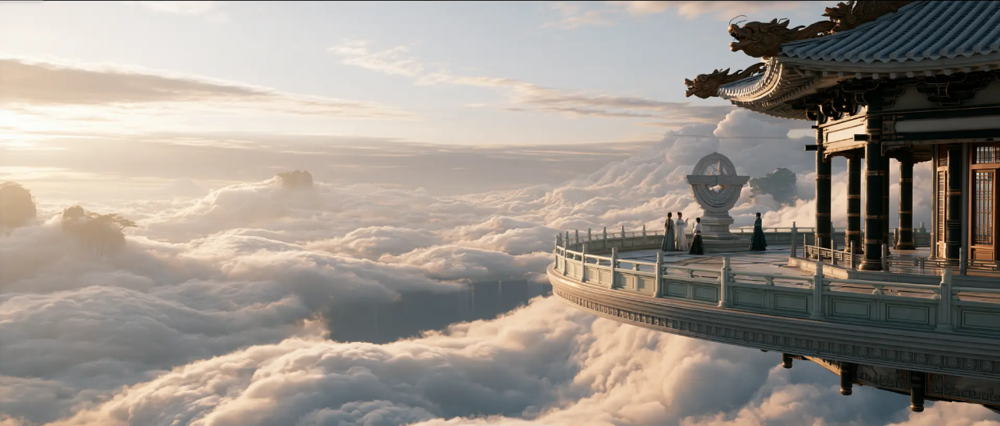

# AI Tech \- Video Structure

## Introduce：

结构化图生文\(基于即梦AI平台的即梦综合AI模型与Seedance模型/ gpt image2\.0？\)

告诉GPT想法，让GPT生成。但是对结果与过程不好把控，GPT需要很长时间才能明白你的偏好

本质是更严谨一些的readme，把大家对场景构思叙述弱的能力，去通过skill把想法/参考图片结构化解析后再喂给ai生成自己想要的。自己明白自己的偏好，根据专业的术语去生成

结构生图/剧本生图/对不同影片/导演/镜头/构图/载体/类型的风格做一个简单的归一化处理，把大量文本处理留置后端，前端只需要做简单风格与类型定位

P\.S：部分关键词容易触发版权问题。有些模型使用英语作为描述prompt最后呈现效果会更好。对主体的具体构建要比大段文字的叙述更重要。也可以通过主体拍摄、AI制作背景的协作来稳定且多元输出成品；
比起一直加“空灵、高级、电影感”，觉得更应该把现场写具体：风从哪里吹、人物正在做什么、哪些地方清楚，哪些地方可以模糊。

分享几个适合这类自然系画面的提示词👇

① 发丝要有方向
`wind-blown strands crossing her eyes and cheeks`
风吹起的碎发掠过眼睛和脸颊。
比只写“飘逸长发”更具体，也能避免头发整齐地向后铺开。想露出五官，就把 eyes 换成 cheeks。

② 抓住没完成的动作
`caught mid-turn, eyes lowered, shoulders relaxed`
转身到一半，眼睛低垂，肩膀放松。
近景可以试试这个组合，让脸、肩膀和身体有一点角度差，减少端正摆拍的感觉。

③ 让衣料进入前景
`wind-lifted fabric sweeping across the lower foreground`
被风掀起的衣料扫过画面下方近处。
像这组图里的白色衣料，靠近镜头时能形成遮挡，画面也更有空间感。记得指定位置，避免挡住整张脸。

④ 模糊要写清楚位置
`face in focus, slight motion blur in the trailing hem`
面部对焦清楚，拖曳的裙摆带一点运动模糊。
我会先保住脸和服装主体，再让边缘动起来。直接写 blurry，容易连想保留的细节一起糊掉。

⑤ 皮肤保留一点生活感
`unretouched freckles, subtle pores, uneven skin tone`
未修饰的雀斑、细微毛孔、轻微不均的肤色。
选两项就够了。瑕疵写得太重，也可能变成刻意强调皮肤问题。

⑥ 把颜色落到具体物体上
`muted olive grass, blue-gray sky, ivory fabric`
低饱和橄榄绿草地、灰蓝天空、象牙白衣料。
比单独写“低饱和”更容易说明整组图的配色关系。

比如近景用“碎发掠过脸颊＋转身未完成”，远景换成“衣料扫过前景＋裙摆轻微模糊”。每张有一点变化，组图才不会像同一个姿势反复出片。

## 结构名词：

出图公式：画面主体与环境置景 \+ 美学调性 \+ 视听摄影与光学系统 \+ 色彩光影 \+ 后期渲染特效

1\.画面主体与环境置景（定死视觉锚点）

❌ 错误：写模糊的主观长句

✅ 正确：拆解为空间位置 \+ 核心置景 \+ 材质细节（如：隧道内部向外观察视角、双股铁轨、碎石道床、远景叠山）。

2\.美学调性（锁定底层美学）

❌ 错误：堆砌“唯美 / 高级感”等情绪虚词

✅ 正确：下达类型学标签（如：Cinematic Still 电影静止帧 / 当代现实主义 / 冒险剧情片）。

3\.视听摄影与光学系统（掌控景深与空间透视）

❌ 错误：只写模糊的“特写 / 远景”

✅ 正确：强制叠加焦距 \+ 光圈 \+ 构图结构（如：35mm lens, f/8、框架构图、铁轨引导线、平视机位、16:9 画幅）。

4\.色彩光影（决定质感生死线）

❌ 错误：“光线柔和 / 阳光明媚”

✅ 正确：指定具体物理光源与明暗反差（如：高反差自然光、前景暗部与远景明部形成明暗对照、自然低饱和色调）。

5\.后期渲染特效（粉碎 AI 塑料感）

❌ 错误：堆叠无意义的“超高清 / 神作”

✅ 正确：锁定感光元件、胶片颗粒与物理引擎（如：模拟 35 毫米胶片颗粒、真实 HDR 光影、虚幻引擎电影渲染风格）。

摄影风格\(根据机器来具体选择\)：

|摄影机\+镜头|适用场景|可复制表达|
|---|---|---|
|ARRICAM LTCooke S4/i50mm 胶片:KODAKVISION3500T5219|剧情短片 荒漠日景|成像参考 ARRICAMLT\+Cooke S4/i 50mm,搭配KODAKVISION3500T 5219胶片;细颗粒随帧变化，亮部柔和，皮肤与布料保留自然纹理。 要点:胶片、扫描与调色共同影响颗粒观感。|
|SONY VENICE 2 ZEISS Supreme Prime 50mm 标准系列·非Radiance|人物访谈 博物馆展厅|成像参考SONYVENICE2，搭配 ZEISS Supreme Prime 50mm;细节清楚不过锐，肤色自然，焦点落在眼睛，背景柔和虚化。 要点:虚化还取决于光圈、焦距和拍摄距离。|
|RED V\-RAPTOR Laowa Proteus35mm T2 2x Blue 变形镜头·S35覆盖|夜景街道 霓虹灯场景|成像参考REDV\-RAPTOR，搭配 Laowa Proteus 35mm T2 2X Blue;强点光源产生克制的蓝色横向耀光，远处失焦灯点呈竖椭圆:画面解挤压后人物比例自然。 要点:光带依附实际光源，不是全屏固定蓝线。|
|RED V\-RAPTOR Laowa Argus35mm T1 FF Cine 球面镜头·本片为RF版|人像近景 灯串游乐场|成像参考 REDV\-RAPTOR，搭配 Laowa Argus 35mm T1 FF Cine;眼睛清楚，背景灯点柔和、偏圆，不刻意添加变形镜头式横向光带。要点:球面镜头也可能耀光，并非绝对无光带。|

摄影机\+镜头是主提示词，效果描述按需补充。使用:右栏接上人物、场景、动作、运镜和对白。本片示例搭配;实际效果以生成结果为准

视角：

|拍法/适用场景|画面效果|可复制提示词|
|---|---|---|
|**低位倾斜** 人物登场/对峙悬疑/态度表达|强化仰视 打破平衡|在【场景】中，将镜头降到【人物】膝盖以下并向上仰拍，保留腿部与上方环境。再让画面轻微倾斜，使桌沿或地平线呈斜线。主体动作清楚，机位固定，保持明显的仰视关系。|
|**面部特写** 表情反应/吃喝情绪转折/细节|集中注意 抓住反应|硬切到【人物】的面部特写，镜头与眼睛等高，发际线到下巴约占画高四分之三，眼神和嘴部清楚。背景简化，重点表现【表情变化】，保持取景大小，不后退展示全身|
|**贴地鱼眼** 鞋履/腿部动作低处道具/互动|放大近处 展开低处空间|在【场景】中，将鱼眼镜头贴近地面，朝【主体】斜向上看。近处腿部或道具显著放大，较远主体缩小，画面边缘的直线明显弯曲。保持主体可辨，固定机仁突出低处空间。|
|**过肩镜头** 双人对话/采访回应/关系交代|带入对话 交代关系|从【人物甲】肩后拍向【人物乙】，甲的肩背占画面一侧少量前景，乙的表情与动作清楚可见。反打时仍在两人连线同一侧拍摄，保持座位和对视方向前景不挡乙的脸。|
|**垂直顶拍** 摆盘/手作演示开箱/桌面操作|看清布局 突出手部路径|用普通直线镜头从【桌面】正上方垂直向下拍，成像平面与桌面平行。若有居中圆杯，杯口应呈圆形桌边不向远处收窄。取景集中在道具和手部，清楚展示\[操作步骤】，不斜拍人物侧脸。|
|**斜俯拍** 多人互动/服务室内/位置交代|交代空间 保留纵深|在\[场景】中，从高于\[主体】的位置斜向下拍，画面保持水平。同时看见人物面部、桌面与物体侧面，保留前后空间，让\[多人动作或物件关系】清楚;不拍成垂直顶视。|
|**前景遮挡** 人物反应/产品空间层次/氛围|分出前后 拉开层次|让\[杯沿、门框或枝叶】贴近镜头，占据画面边缘少量区域并柔化;让中景的\[主体\]保持清晰，远处环境形成第三层。前景不遮脸或关键动作，焦点保持在主体，保留三个距离层次。|
|**鱼眼镜头** 俏皮结尾/互动近距离夸张/趣味|夸张透视 增添俏皮|使用鱼眼镜头近距离拍摄\[人物】，人物靠近画面中心，周围窗框等线条向边缘明显弯曲。让人物轻微前倾，近处脸部或道具更大、远处更小;机位固定，形成俏皮夸张的互动。|

使用:替换\[ \]内容，将对应段落加入单个镜头提示词。

要点:低位看机位，特写看取景范围。

场景细节：

|细节/适用场景|画面效果|可复制提示词|
|---|---|---|
|**薄雾** 厂房/仓库森林/长廊|显出光束 拉开层次|在\[场景\]中加入稀薄、均匀的薄雾。让\[窗光或阳光\]从侧后方照入，光束在雾中清晰可见。保留环境细节与人物暗部，雾层轻缓流动，不形成浓白烟墙。|
|**浮尘** 书库/谷仓老屋/旧仓库|亮点漂浮 增加空气感|在\[场景\]的窗边，让少量细小尘粒在一束侧逆光里缓慢漂浮。粒子大小与远近略有差别，深色背景衬出亮点。尘粒彼此分离，不连成烟雾，不铺满画面。|
|**火花** 篝火/营地海岸夜景|细节有动势 暖光勾轮廓|在\[篝火场景\]中，让少量橙红火花从火堆上方升起，随气流短暂飘过人物脸旁。火花自身发亮逐渐变暗消失。火堆位于人物侧后方，暖光勾出肩部与发丝轮廓，脸部保留暗部|
|**逆光** 雨雨夜街道树林/小巷|雨丝更清楚 空间有层次|在\[雨夜场景\]中，让\[车灯或强光\]位于持伞人物后方，朝镜头方向照亮雨幕。人物处在相机与光源之间，身体两侧出现清楚的亮雨丝，背景较暗。脸部保留暗部，伞缘自然滴水;不以大片白雾代替雨线。|

打光：

|灯光/适用场景|画面效果|可复制提示词|
|---|---|---|
|伦勃朗光 古典肖像/访谈剧情人物特写|暗侧眼下 小亮三角|为\[人物\]使用伦勃朗光。主光从脸部侧上方斜照，调整灯位与脸朝向，使鼻影连接颊影，在暗侧眼下保留一小块三角亮区。暗部保留层次，突出面部立体感。|
|蝴蝶光 美妆肖像复古明星照|鼻下短影 突出颧骨|为\[人物\]使用蝴蝶光。主光置于脸部正前上方并对准中轴，在鼻子正下方形成短而对称的蝴蝶形阴影。保持眼睛有光，颧骨和下颌线清晰，鼻影止于上唇之前。|
|分割光 悬疑/黑色电影戏剧人物肖像|半边脸亮 半边脸暗|为\[人物\]使用分割光。主光从脸部正侧方照入，使一侧脸受光、另一侧进入阴影，明暗分界接近脸部中线。人物保持稳定朝向，暗侧保留少量细节，突出戏剧张力。|
|轮廓光 暗背景人像舞台/时尚肖像|发丝肩线亮边 分离人物背景|为\[人物\]使用轮廓光。光从背后或侧后方擦过，在发丝和肩线形成清晰窄亮边，使人物从\[深色背景\]中分离。正面加入微弱填光，保留眼神与表情，亮边保留细节。 |
|夜景聚光 夜间球场/街巷树林/舞台|主体局部亮 四周环境暗|在\[夜景场景\]使用聚光照明。从人物前侧上方投下一束受控窄照亮\[人物\]与脚边小片地光，面，周围保持较暗并保留环境层次。固定照射方向和光区。需要空气光束时，再加入少量薄雾。|

镜头：

|镜头方法|适用情况|可复制表达|
|---|---|---|
|推进|强调反应 营造压迫|机位沿桌子中轴向人物靠近;由中景收至胸上，末段减速收稳。 要点:人物不前探;前景退出要有视差。|
|拉远|揭开全貌 制造反差|机位从人物正前方向后退;逐步露出整辆小车，放缓后停稳。 要点:车留在原位，不靠倒车制造缩小。|
|横摇|转移视线 依次揭示|机位留在原处，水平向右转;扫过队列，在高矮两人同框处停稳。 要点:转动镜头朝向，不把机位横移。|
|向上摇|逐层揭示 延后揭晓|固定低机位，镜头由下向上转;从车轮掠过箱层，最后落到人物脸。 要点:改变俯仰方向，不把机位整体升高。|
|甩镜|突然换看点 衔接动作|人物指向右侧后，镜头迅速右甩;途中短暂模糊，到追逐者处刹稳。 要点:方向由动作触发，收稳后看清新目标。|
|跟拍|维持追逐 交代关系|机位侧向平行跟随奔跑者;本例人停时镜头停，再跑时跟上。 要点:人物前方留空间，保留彼此距离关系。|
|手持|贴近行动 加强紧迫感|机位近距离跟跑，随落脚轻微起伏;边跑边作小幅修正，脸仍看得清。 要点:强调受控的现场感，不靠剧烈乱抖。|
|环绕|展示周围 揭开幕后|人物站定，机位从正面沿弧线绕行;中段加快，到背后放缓并露出设备。 要点:移动的是摄影机，人物不自己转圈。|
|急推/急拉 变焦|放大细节 揭示反转|机位不动:急推时迅速收窄取景;急拉时迅速扩大取景，随后收稳。 要点:与前后移机区分;不用叠化代替变焦。|
|滑动变焦|突出情绪 制造空间反差|机位靠近人物，同时连续拉广取景;本片人物变大，远处门厅变小。 要点:本片变体;经典写法常保持主体近似等大。|
|子弹时间|展开瞬间 看清悬停关系|甜甜圈脱手后，人物与圈接近定格;镜头沿甜甜圈方向推近，落到人物脸。 要点:近停时仍改变视点，不是定帧截图缩放。|
|慢动作|突出接触 看清关键一刻|两杯正常靠近，接触前后放慢;轻碰一次即分开，再正常收杯。 要点:接触处清楚:动作减慢，画外对白正常。|

焦距：

|焦距|适用情况|可复制表达|
|---|---|---|
|24mm|人物\+环境|24mm广角感，全身入画;人物周围保留清楚的环境。|
|70mm|突出人物|70mm中景感，腰部以上入画;人物更大，背景取景范围更少。|
|135mm|看清表情|135mm特写感，头肩入画;眼睛和脸清晰，背景柔和。|
|200mm|远处观察|200mm远距特写，百叶窗作前景;连续收紧到清晰脸部，停稳。|

比较前提:画幅、机位、主体位置和裁切保持不变。

景别也受拍摄距离影响;背景取景少，不等于一定更虚。

数值用于描述AI画面目标，非物理实测;实际效果依模型而异

光圈：

|光圈数值\+ 对焦位置\+ 清晰与虚化范围 按你想要的效果选一条，加入完整的视频提示词。||
|---|---|
|f/1\.4|专注表情或细节 浅景深，对焦主体关键细节，焦点清晰，背景明显虚化|
|f/2\.8|突出人物，交代环境 对焦人物双眼，人物清晰，背景柔和虚化，环境轮廓仍可辨认|
|f/8|看清人物与周围空间 较深景深，对焦中景主体，前后景中的主要人物和物体保持可辨。|
|f/16|展示风景与远近层次 深景深，结合构图设置对焦位置，让近景到远景保留可辨结构。|

同等条件下:f数越小，景深越浅;f数越大，景深越深。

景深还受焦距、距离和对焦位置影响;以上为AI画面目标，以成片为准。

## 例子分析：

### 结构化生图：

AI生图提示词:

画面主体与环境置景/核心元素:年迈的地精类humanoid怪物、巨大尖耳、鹰钩鼻、深邃皱纹、灰白长发与胡须、破旧皮革肩甲、粗糙布质围巾、肩带与金属扣件、

背景中的模糊武装随从与沙漠建筑/美学调性:奇幻冒险、黑暗奇幻、史诗电影感/神话中世纪时代、架空中古世界/午后日间/室外/具体置景:荒漠要塞或沙漠军营\|沙土色石墙、风化建筑、金属与皮革装备、重型机械或攻城器械轮廓、成群模糊士兵、尘土环境与远处高墙

\#主体细节，\#画面风格/主题风格 \(脑海中的置景与世界构思越清晰，越容易构造出\)

AI生图提示词:画面主体与环境置景

核心元素:蓝灰色外星类人生物战士，Alien humanoid wamfior/外星类人生物战士，重型生物机械装甲，发光橙色能量装置，冰雪与火山荒原

远处火焰与烟雾美学调性:科幻动作/黑暗奇幻/史诗冒险/未来时代/白昼阴天/室外量节点，背景包含积雪山地、黑色岩石、低空烟尘、远处熔岩火光与模糊山脊

具体置景:异星战场与冰雪火山荒原\|前景为覆盖鳞状纹理与机械结构的厚重肩甲和护臂，中景为外星战士面部与胸甲，装甲上嵌有橙金色发光能

视听摄影与美学工业后景制造层次

镜头构图:2\.35:1宽银幕比例/电影级写实CGI与真人电影概念艺术格式/中近景，胸像特写结合前景遮挡/平视略微仰拍，突出角色压迫感/

约85毫米中长焦，约f/28大光圈，浅景深/三分法构图，主体位于左侧三分之一，前景装甲形成斜向引导线，右侧保留大面积负空间，利用前中

色彩光影:冷蓝灰与炭黑主色，橙金色能量光形成互补色对比/阴天漫射光结合强烈轮廓光、局部高光与电影级低调照明/主要光源为上方阴天天

光、右后方冷色环境光、装甲能量节点的橙色自发光，以及远处火焰和熔岩反射光

后期特效:高细节外星皮肤与装甲材质、橙色能量核心辉光、体积烟雾、远景热浪、火焰散景、环境粒子与景深合成/电影级PBR材质与虚幻引擎5式实时渲染质感，结合数字生物特效、HDR高动态范围、柔和镜头光晕与真实胶片级色彩分级

\#主体元素，\#风格，\#画面结构，\#构图，\#镜头技术，\#呈现风格，\#色彩光影

AI生图提示词:画面主体与环境置景美学调性:黑暗奇幻史诗/中世纪架空神话时代/深夜/室外

核心元素:兽人部落，祈祷中的首领兽人，环绕火堆的兽人战士，尖耳獠牙生物，毛皮与兽骨饰品，木碗与陶罐，篝火，飞舞火星，烟雾

具体置景:森林部落营地\|巨木环绕的林间空地、中央篝火、粗糙石块、兽骨、木制与陶制容器、毛皮铺垫、兽人武器、原始部落祭祀与集会氛围

特效风格：视听摄影与美学工业与林间天光作为轮廓及环境光虚幻引擎式实时电影渲染与高端数字合成

镜头构图:2\.35:1宽银幕比例/写实电影摄影与高精度数字生物特效/中大全景群像/平视略带低机位/约35毫米焦距，约f/2\.8浅景深/中央对称构图、视觉中心置于祈祷中的首领、前景遮挡形成框景、火堆形成引导线

色彩光影:冷蓝与炽热橙红的互补色调、低饱和泥土色/强烈明暗对比、火光闪烁、体积烟雾、边缘轮廓光/前景簧火与营火为主光源，冷色月光

后期特效:真实火焰、飞散火星、烟雾粒子、空气透视、数字生物妆效与皮肤纹理增强、毛发与布料模拟/电影级PBR写实渲染、路径追踪质感

\#画面主体/核心元素，\#环境置景美学调性，\#具体置景，\#特效风格，\#镜头构图，\#色彩光影

AI生图提示词:

【画面主体与环境置景】

核心元素:拟人化灰白色猫科角色，蒸汽朋克护目镜，棕色皮革飞行帽，锐利蓝绿色异色瞳，胡须与獠牙，厚重浅色毛发，围巾与皮革装备

美学调性:蒸汽朋克冒险电影/复古未来主义与西部拓荒时代，约19世纪末至20世纪初/白昼、偏午后/室外

具体置景:荒漠边境聚落或尘土飞扬的机械化前哨\|背景虚化的棕色机械装置、皮革装备、浅色尘土环境与明亮蓝天，整体呈现粗栃的旅行者营地氛围

\[视听摄影与美学工业\]

镜头构图:约2\.52:1超宽银幕比例/写实电影概念艺术与高精度CG渲染/极近特写，面部占据画面主体/正面平视机位，略带轻微低角度压迫感

/约85至100mm人像长焦，约f/2\.0至f/2\.8浅景深/中央对称构图、视觉中心聚焦双眼，利用护目镜与胡须形成水平及放射线引导

色彩光影:青蓝天空与青绿色眼睛对比暖棕皮革、金铜金属和奶油色毛发的冷暖互补调色/电影级自然光、强烈高光、柔和阴影、边缘轮廓光与浅

景深散景/低角度暖色太阳光作为主光，天空环境光作为冷色补光，皮革与金属产生定向反光

后期特效:高细节毛发模拟、异色瞳虹膜增强、金属磨损与皮革纹理强化、空气尘埃与背景散景、轻微镜头光晕和胶片质感\|电影级写实CG渲染

PBR材质、路径追踪光照、细腻毛发着色与自然景深，接近虚幻引擎或Arnold式高端视觉质感

\#主体，\#风格，\#置景，\#构图，\#色彩，\#特效，\#光影，\#细节呈现

AI生图提示词:画面主体与环境置景

美学调性:历史史诗/神话冒险/前哥伦布时期，中美洲阿兹特克文化背景/日间偏午后黄金时段/室外兽皮与织物、长矛和仪式权杖、聚集的舞者与祭司队列

核心元素:阿兹特克风格羽毛头饰祭司、持长杖的中心仪式领袖、佩戴面具与贝壳饰品的舞者、部落仪式人群、石制神庙遗迹、棕相树与热带植被

具体置景:古代中美洲神庙广场\|雕刻石墙、阶梯式祭坛、浮雕墙面、石制遗迹、热带棕榈树、仪式服饰、羽毛冠、贝壳项链、玉石与绿松石饰件

视听摄影与美学工业镜头构图:2\.35比1/写实电影摄影与高预算历史史诗美术格式/中广景与全身人物群像，前景人物局部遮挡形成层次/低机位仰拍，接近人物视线下方/约35毫米广角镜头，约f2\.8浅景深/前景、中景、远景分层构图，中心偏左主体强调，利用神庙阶梯与人物队列形成引导线，非对称平衡与框中框构图辅以胶片颗粒、柔和高光晕染和自然色彩分级

色彩光影:赭石、沙金、棕褐色为主，辅以绿松石、孔雀蓝、朱红与黑色羽毛的高饱和民族色彩/温暖、柔和、带空气透视的电影级自然光，轮廓光明显，局部高光与柔和阴影并存/低角度太阳光、侧逆光、天空环境光、石墙反射光与薄雾散射光

后期特效:轻度体积雾、空气尘埃、热气流、背景景深虚化与运动模糊/电影级写实渲染质感，类似Unreal Engine 5或V\-Ray的高细节数字场景

AI生图提示词:画面主体与环境置景美学调性:历史奇幻/前哥伦布时期中美洲古文明/清晨或上午早段/室外粗粝岩石，人物排列在神庙前方形成仪式性队列

核心元素:身披深红斗篷的祭司与部族成员、羽毛与尖刺头饰、中央石阶金字塔神庙、热带密林、茅草屋、长矛、祭祀烟雾、潮湿森林地面

具体置景:热带雨林中的古代部落祭祀广场\|两侧分布大型茅草屋与原始石墙，中央为被丛林包围的阶梯式石制金字塔神庙，前景为苔薛、落叶与

视听摄影与美学工业

镜头构图:2\.35:1/电影宽银幕写实摄影/远景至大全景/低机位正面视角，接近地面高度/约35毫米广角镜头，T2\.8至T4景深/中央对称构图、中心消失点、前景框景、引导线构图与三分法结合

数字合成与自然色彩分级

色彩光影:深森林绿、青灰雾色、泥土棕与祭司暗红斗篷形成冷暖对比/自然主义明暗光、低调度电影光、强烈体积光与薄雾漫反射/清晨斜射阳光穿透树冠形成可见光束，辅以火盆或祭祀烟源的局部暖光

后期特效:体积雾、光线追踪式光束增强、烟雾粒子、环境空气透视、细微镜头光晕与胶片颗粒/写实电影级物理渲染质感，真实材质反射，适度数字合成与自然色彩分级

AI生图提示词:

画面主体与环境置景核心元素:巨型翼龙坐骑，身穿蓝金色重甲的年轻骑士，飞行鞍具与缰绳，展开的蓝绿色与赤红色翅翼，山谷聚落，远方群山与森林

美学调性:史诗奇幻/虚构中世纪时代/午后偏傍晚的黄金时段/室外具体置景:高空山谷与幻想山地聚落\|石砌房屋、木制栅栏、旗帜、山崖、森林、峡谷、远景山脉与被阳光照亮的村落建筑视听摄影与美学工业

镜头构图:2\.35:1超宽银幕比例/写实CG电影格式与真人电影质感/中远景动态主体镜头/略低机位侧向追踪视角/约35mm广角镜头，约f/4光圈/对角线构图、三分法、前景遮挡与运动方向引导

色彩光影:青绿色深蓝、赤红、铜金与暖棕色的高饱和史诗色彩/强烈电影级自然光、体积光、边缘轮廓光与动态运动模糊/低角度金色太阳光天空漫反射与山谷环境反光

后期特效:飞行速度感、翅翼运动模糊、景深虚化、空气透视、薄雾、尘埃微粒、鳞片与羽毛细节增强/高端写实CG渲染质感，接近Unreal Engine 5级别的实时电影渲染、PBR材质、HDR高动态范围与数字合成

AI生图提示词:

画面主体与环境置景/核心元素:拟人化熊猫战士、巨型弯刀、背负木桶与武器、皮革与布艺护甲、森林聚落、远景村民、篝火、木制栈道、石墙、山洞入口

美学调性:奇幻冒险、东方武侠、medieval式英雄喜剧气质/时代背景架空古代东亚、中世纪乡野文明

时间段:黄昏前的晚下午/室内或室外:室外/具体置景:森林山地村落与临时营地粗木棚屋、缠布树柱、兽皮遮棚、木桶、武器架、石砌矮墙、山洞、木板道路、木制招牌、杂乱摊位、篝火、铁匠工具、藤蔓与苔藓

视听摄影与美学工业/镜头构图:2\.35比1宽银幕比例/写实电影级CGI与数字matte painting艺术格式/中远景、全身英雄展示景别/略低机位仰拍/约35毫米广角镜头、约f2\.8大光圈/三分法构图、前景框景、中心偏右主体、道路引导线、层次化景深构图/色彩光影:金绿色、棕褐色、炭黑与暖橙色调，电影级暖色复古奇幻质感

光效风格:黄昏斜射光、树叶间斑驳光、柔和轮廓光、局部高光与体积雾/具体光源类型:自然夕阳、篝火火光、环境反射光、森林顶部散射光/后期特效:写实毛发模拟、布料与皮革材质细节、体积光、空气透视、景深、轻微烟雾、火焰粒子与环境遮蔽/渲染引擎或技术质感描述:高端电影级物理渲染、PBR材质、真实毛发渲染、数字合成与电影调色质感

AI生图提示词:

画面主体与环境置景核心元素:巨型兽人首领，身披兽皮与骨甲的部落战士，正面持战斧的孤勇战士，兽角帐篷，骨制图腾与战旗，峡谷部落营地，远古岩柱，

烟雾与尘埃美学调性:史诗奇幻/神话战争/远古部落时代/午后偏晚时段/室外

具体置景:荒漠峡谷部落聚落\|两侧矗立着层叠砂岩峭壁与巨型岩柱，营地由兽皮帐篷、木桩、兽骨、獠牙、盾牌、战旗、祭祀图腾和简陋木制平台构成，泥土地面带有积水反光，远景弥漫烟柱与尘雾，中央形成通往巨兽首领的仪式性通视听摄影与美学工业

镜头构图:2\.35:1宽银幕比例/写实电影级CGI与真人电影质感融合/超广角大全景与史诗建立镜头/低机位仰拍/24至28毫米广角镜头，约f/8光圈，中等景深/中央对称构图、中心主体强调、前中后景分层峡谷与营地道路形成引导线、框架式构图

色彩光影:沙金色、赭石色、焦糖棕、岩灰色与烟雾蓝灰色的干燥大地色调/强烈自然光与厚重体积雾结合，明暗对比鲜明，边缘轮廓光突出巨兽与战士，具有尘土过滤后的柔化高光/右后方低角度太阳光、天空散射光地面反射光与烟雾中的体积光

后期特效:巨型兽人首领与远景生物的高细节数字角色，烟柱、尘埃、薄雾、空气透视、湿地反光与粒特效/采用虚幻引擎5式实时渲染质感，结合电影级PBR材质、数字生物毛发与皮肤细节、全局光照、环境遮蔽、HDR调色和高质量景深

AI生图提示词:【画面主体与环境置景】人，前景瓦顶与栏杆美学调性:奇幻史诗/东方历史幻想、古代风格的架空时代/日落黄昏/室外

核心元素:层叠式东方古塔与寺院建筑,East Asian pagoda temple \(东亚风格宝塔寺院\)，山崖瀑布，云雾群山，远景宫殿群，台阶与微小行

具体置景:山地寺院与悬崖建筑群\|多层木构塔楼、飞檐、雕饰屋脊、灯笼与窗格、石阶、瀑布、远山宫殿、前景屋瓦

【视听摄影与美学工业】中央主体构图、前景与阶梯形成引导线、远近景分层

镜头构图:2\.39:1/数字电影级奇幻概念美术/大远景、环境建立镜头/略高机位斜向俯视/广角约28\-35mm，虚拟光圈约/8、较深景深/

色彩光影:暖琥珀金与珊瑚橙天空，辅以冷青灰阴影/电影感逆光、体积雾与大气透视、柔和轮廓光/低角度夕阳为主光，寺院窗灯与灯笼为暖色实景光源

后期特效:数字环境扩展、云雾与瀑布氛围特效、远景大气透视/高细节写实风格CG与数字绘景质感，渲染引擎未能从画面确定

AI生图提示词:画面主体与环境置景美学调性:奇幻武侠/历史幻想时代背景\(仿古东亚风格\)/夜晚/室内

核心元素:身着华丽古装的中央女舞者、数名腾空表演者、围观人群、环形多层木质戏楼、雕花圆形装置

具体置景:大型室内剧场或戏楼\|多层环形木质看台、红色立柱、雕花栏杆、悬挂灯笼、中央装饰性圆形舞台装置、密集观众与高处天窗

视听摄影与美学工业镜头构图:约2\.37:1/电影级写实影像、数字合成质感/大远景/低机位仰拍/超广角镜头、较深景深\(光圈推测约f/5\.6\-8\)/中央对称构图、环形纵深引导、中心主体突出

色彩光影:深琥珀色、铜金色与暗红色/明暗反差强烈、体积光束与薄雾营造戏剧性光影/顶部天窗冷白光、室内暖色灯笼与烛火

后期特效:腾空与悬吊表演的数字增强、体积雾、光束与粒子尘埃/高细节电影级CG合成，写实材质与戏剧化调色

AI生图提示词:

画面主体与环境置景核心元素:东亚女性肖像，ornate floral headdress\(繁复花饰头冠\)，深红花朵，金色刺绣礼服，飘动的薄纱

美学调性:历史奇幻/华丽宫廷戏剧/架空的古典时代/室内/暖色室内夜景或无明确时刻

具体置景:宫殿式宴会厅或戏剧性内景\|红金色墙面与拱形结构，发光窗格，金色帷幔与装饰，近景飘动薄纱

视听摄影与美学工业镜头构图:约2\.35:1/真人电影摄影/中近景/平视略低机位/约50\-85mm人像镜头、浅景深\(约f/2\-2\.8\)/人物偏右置于三分线附近，前景纱幕形成框景与纵深色彩光影:琥珀金、暖棕与深红/柔和漫射光结合高反差轮廓光,朦胧辉光/画外暖色人工灯、窗格状实景灯及金色反射光

后期特效:轻微风动纱幕与发丝，柔光辉光及浅景深/写实电影调色与细腻胶片质感，未见明显数字特效

AI生图提示词:\[画面主体与环境置景\]美学调性:历史宫廷剧情/古代中国风格\(具体朝代不确定\)/黄昏入夜/室外

核心元素:古代东亚宫廷仪典，中轴线上的单独人物，两侧列队的朝臣与人群，对称排列的宫灯，宏伟的木构宫殿

具体置景:皇宫中轴广场\|湿润石板地面与中央纹饰长道，两侧成列灯笼、肃立人群和对称宫殿楼阁，尽端为高台主殿与宽阔台阶

【视听摄影与美学工业】镜头构图:约2\.35:1宽银幕/写实电影感数字影像/大远景与全景/近水平略低机位，正面轴线视角/焦距与光圈无法由单帧可靠确定，呈广角深景深观感/中轴对称构图、引导线与消失点居中

色彩光影:冷蓝黑夜色与暖琥珀金灯火形成强烈冷暖对比/低调戏剧性照明，灯火辉光与湿地反射/宫灯、建筑檐下灯火及天际残余暮光

后期特效:可见的烟雾或体积光氛围与灯火辉光，整体偏电影化调色;具体特效流程与渲染引擎无法从画面确认

AI生图提示词:【画面主体与环境置景】核心元素:古装女子,young womanin a crimson robe\(身着绯红长袍的年轻女子\)，发饰与古典发型，圆形月洞门,中式庭院，竹林，假山与石径，传统中式建筑美学调性:古装历史剧/东方奇幻与抒情剧情片气质/古代中国风格时代背景\(具体朝代不明\)/白昼、午后感/室外具体置景:传统中式庭院\|女子立于圆形月洞门中央，门后可见灰瓦木构建筑与石径;两侧布置竹林、树木、花草、假山和景石，营造层次丰富的

园林空间

【视听摄影与美学工业】

镜头构图:约2\.35:1/电影感实景摄影/中远景、人物约膝上至全身感构图\(下缘裁切\)/平视略带低机位感/焦距与光圈不可由画面确证，呈

中广角空间感、浅至中等景深，估计约35\-50mm、f/2\.8\-f/4/居中对称构图、圆形门洞框景、前中后景分层

境天光补光，局部暖色反射光特定渲染引擎

色彩光影:暗绿与暖金为主，绯红衣袍形成醒目点色/自然柔和的明暗交错光、树影斑驳、电影式反差与轻微暗角感/日光穿过树冠作为主光，环

后期特效:未见明显视觉特效，以实景园林与自然光为主，辅以电影级调色/写实数字影像质感，细腻胶片式颗粒与高动态范围观感，无可确认的特定渲染引\|擎

AI生图提示词:\[画面主体与环境置景\]

核心元素:骑自行车的少年，少年侧脸微笑，复古单车，乡村农田，石砌矮墙，远处山丘，果树与农作物，地中海乡野景观

美学调性:成长电影/现实主义乡村剧情/当代或无明确年代的欧洲乡村时代背景/午后至傍晚/室外

具体置景:乡村农田与山谷场景\|前景为粗粝的天然石砌矮墙，中景是干燥土壤、低矮农作物、果树与木桩，远景为起伏的棕绿色丘陵、零散民居

与乡间道路，整体呈现南欧或地中海农业村落质感

\[视听摄影与美学工业】\]

积环境负空间，石墙与田垄形成水平线和引导线天空漫反射作为补光，石墙与土地产生自然反射光I1\-of、轻微镜头晕光与自然景深，接近ARRIAlexa或胶片扫描质感

镜头构图:2\.35:1宽银幕比例/写实电影摄影、横向宽银幕格式、轻微模拟胶片质感/中景至中近景/侧面平视机位，略带轻微低角度感，镜头

与骑行者平行跟拍/约50mm等效焦距，约1/4光圈，主体清晰、背景适度桑化但保留环境信息/三分法构图、人物位于右侧三分线，左侧保留大面

色彩光影:低饱和暖棕、橄榄绿、麦秆金与石灰米色/自然主义黄金时段光效，桑和暖光、轻微逆光轮廓与温和阴影/低角度午后太阳作为主光源

后期特效:无明显数字视觉特效，以真实环境摄影为主，轻微运动跟焦与自然动态模糊/写实电影级数字调色，模拟35毫米胶片颗粒、柔和高光roll\-off、轻微镜头晕光与自然景深，接近ARRIAlexa或胶片扫描质感

AI生图提示词:画面主体与环境置景

核心元素:骑自行车的年轻男性，青年行人动态残影，黑色公路自行车，铁路轨道，铁路枕木与碎石，乡野田野，热带植被与棕榈树，远山，电线杆

与架空电缆，逆光剪影

美学调性:现实主义剧情片/当代约2010至2020年代/黄昏黄金时刻/室外

具体置景:乡村铁路沿线与热带山谷\|前景为双轨铁路、木质枕木、深色碎石道床和野章，中景为骑行者与铁丝围栏，远景为农田、低矮民居、棕

榈树和层叠山脉，左侧设置高耸木质电线杆及架空线路，整体呈偏远乡郊交通景观

视听摄影与美学工业环境补光，地面反射光形成微弱轮廓光高动态范围渲染，无明显CG合成感

镜头构图:2\.35:1/写实电影摄影、宽银幕叙事格式/中远景至全身景别/略低机位侧面视角/约35至50毫米镜头，约f/5\.6至f/8/三分法

对角线引导线、前景框架、主体置于画面右侧并利用铁路轨道引导视线

色彩光影:低饱和暖棕色、琥珀色与烟灰绿色调/强烈逆光、剪影效果、柔和大气透视、局部高光溢出/低角度夕阳作为主光源，天空漫射光作为

后期特效:真实运动模糊、行人动态拖影、空气雾霾与远景大气透视、轻微胶片颗粒和高光晕染/实拍电影质感，数字中间片调色，偏自然主义的

AI生图提示词:画面主体与环境置景核心元素:宏伟的东方奇幻秘境图书馆，穿着长袍的修行者与学者，多层木质回廊，巨型

雕金立柱，悬浮岩岛，高空瀑布，雾气,红色宫灯，英文主体:grand oriental fantasy archive, robed cultivators and scholars, multi\-level wooden galleries, monumental gilded columns, floating rock islands, cascading waterfalls, mist, red lantern美学调性:史诗奇幻/架空古代东方与神话时代/白昼/室内与室外融合具体置景:超大型东方宫殿式藏书楼与秘境圣殿\|黑檀色木梁、雕花栏杆、金色天文与符文纹样环形多层书架、螺旋楼梯、垂落的半透明白色帷幔、远处破碎山体、悬空平台、群瀑、石桥、木质地板、前景栏杆、暖色宫灯与散火视听摄影与美学工业镜头构图:2\.39:1/电影级数字环境概念艺术与写实CGI/超广角大全景建立镜头/低机位至平视之间的广角视角，约24mm，深景深约f/8/前景栏杆、中景人物、后景建筑与瀑布形成多层纵深;建筑垂线强化主严感，中央空间形成视觉焦点，回廊与楼梯作为引导线色彩光影:冷青灰与深棕黑为主，辅以金铜色与朱红色点缀/戏剧性明暗对照、体积光、薄雾浸反射、柔和高光/右侧高窗投射的冷色自然日光、室内烛火与暖色宫灯、局部反射光后期特效:体积雾、云雾穿透光束、悬浮建筑与岩石、动态瀑布、水汽、远景大气透视、微粒与镜面反射/高端电影级物理写实渲染，PBR材质、光线追踪质感、Unreal Engine 5式实时渲染与数字 matte painting 融合

AI生图提示词:画面主体与环境置景核心元素:悬浮于云海之上的东方仙侠宫城，巨型中央天文钟与环形时空装置，多层飞檐斗拱建筑群，空中帆船与浮空舰队，高耸塔楼与旗幡，云海、雪山与悬浮岩台，前景四名身着古代东方服饰的人物美学调性:史诗奇幻/东方神话与架空古代文明融合/黄昏至日落时分/室外具体置景:空中仙城与云端圣殿\|对称轴线布局的巨大中央钟塔、环形石质平台、青铜与石材塔楼、黑色琉璃瓦屋顶、木质回廊、雕花栏杆、暖色灯笼、悬挂旗帜、云海悬桥、远景浮空岩石山脊与云层下方的高山地貌视听摄影与美学工业镜头构图:2\.35:1宽银幕比例/电影概念艺术与写实数字matte painting/超大全景远景/近似人眼高度的正面水平机位，轻微俯视宏观景观/约24mm广角镜头，约f/8至f/11深景深/中央对称构图、消失点居中、前景框景、三分法层次与引导线构图色彩光影:冷蓝灰、银白云雾、青铜褐与琥珀金的低饱和史诗色调/体积光、柔和漫射光、薄雾散射、边缘轮廓光与高动态范围光影/右上方低角度夕阳作为主光源云层反射光作为环境补光，建筑灯笼提供前景暖色点光后期特效:巨型悬浮建筑、云海、空中舰船、体积雾、光线穿透云层与微型火的数字合成/电影级数字matte painting、PBR材质、HDR渲染、真实大气透视、细腻云体模拟与高细节概念艺术质感

AI生图提示词:【画面主体与环境置景】核心元素:悬浮于云海之上的中式仙宫楼阁，四位身着古代长袍的人物，巨型青铜日暑或天文仪，雕刻龙首的重檐屋顶，白玉石栏杆与环形露台，云海与远山美学调性:东方仙侠奇幻/神话时代与架空古代中国/日落前后的黄昏时段/室外具体置景:天界宫殿露台\|悬空建筑平台、青灰色琉璃瓦、龙形屋脊装饰、深色木质立柱金色构件、白玉栏杆、石质地面、圆形天文仪、木格窗、层叠云海、远处云中山峰【视听摄影与美学工业】镜头构图:约2\.351超宽银幕比例/电影级数字奇幻艺术格式、写实CGI与matte painting视觉风格/超远景或大全景establishing shot/平视略微俯拍机位/约28mm广角镜头，约f/8至f/11深景深/三分法构图、右侧建筑形成视觉锚点、左侧大面积留白、露台弧线与栏杆形成引导线、人物作为尺度参照色彩光影:暖金色、米白色、青灰色深棕色的低饱和东方古典色盘/柔和的电影级体积光、边缘轮廓光、云层漫反射与轻微逆光/左侧低角度夕阳为主光源，天空散射光与云海反射光为辅光源，建筑局部产生柔和阴影后期特效:体积云雾、云海层叠、远景大气透视、悬浮建筑视觉效果、柔和镜头晕、细微景深与环境雾化/高细节写实CGI与数字 matte painting质感，类似Unreal Engine或V\-Ray电影级渲染，真实材质、HDR光照与大气渲染

AI生图提示词:【画面主体与环境置景】核心元素:悬崖山城,Cliffside mountain city\(悬崖山城\)

传统中式楼阁与多层飞檐建筑, Chinese pagodas and tiered eaves\(传统中式楼阁与多层飞檐建筑\)，中央巨型城门与宫殿，monumental palace gate\(巨型宫殿城门\)，远古群山与岩壁,ancient mountains and cliffs\(远古群山与岩壁\)，白花古树,flowering ancienttree\(白花古树\)，石雕瑞兽，stoneguardian beast\(石雕瑞兽\)，四名古装人物，fourrobed figures\(四名古装人物\)，雾气与瀑布般的蒸汽, mist and vapor cascades\(雾气与瀑布般的蒸汽\)美学调性:东方玄幻/武侠仙侠冒险/架空古代中国，偏唐宋建筑美学/黄昏暮光时段/室外具体置景:悬崖山城与峡谷聚落\|密集木构吊脚楼、深色雕花梁柱、琉璃瓦屋顶、层叠飞檐、中央宫殿城门、悬空栈道与桥梁、山体窑建筑、石雕瑞兽、临崖木平台、灯笼、火盆、古树、远山云海与蒸汽瀑布【视听摄影与美学工业】镜头构图:约2\.64:1超宽银幕比例/电影级数字概念艺术与写实CG场景/极远景建立镜头，带前景人物与环境叙事/略高于视平线的广角机位/约24毫米广角镜头，约f/5\.6至f/8，深景深/中央宫殿轴线形成近似对称构图，前景人物与石兽构成视觉锚点，屋檐和古树形成框景，桥梁与建筑线条引导视线，前中后景分层色彩光影:青灰岩壁与墨黑木构结合琥珀橙、铜红和暮霞粉的冷暖对/电影化体积光、轮廓光、逆光与火光交织，局部高对比明暗塑形/夕阳低角度自然光、宫灯与窗内烛火、火盆与熔岩般的暖色反射光后期特效:体积雾、烟尘、火星飞溅、远景大气透视、蒸汽瀑布、微弱辉光与火焰粒子/物理渲染写实CGI质感，类似Unreal Engine或Octane的高细节实时电影渲染，结合数字 matte painting与概念设计质感

AI生图提示词:【画面主体与环境置景】核心元素:巨型天体浑仪与多重环形机械装置，身着长袍的仪式性人物群像，宏伟的魔法图书馆与天文观测大厅，穹顶玻璃天窗，悬垂紫色花卉与白色云雾，木质雕刻巨柱，镀金栏杆与环形平台美学调性:史诗奇幻/神秘学科幻/蒸汽朋克幻想/无明确历史年代的神话时代与未来复古融合/白昼/室内具体置景:大型acane天文图书馆与星象观测圣殿\|中央悬浮式天体仪、铜金色轨道环、刻有符文的机械结构、层叠书架、拱形木柱、玻璃穹顶、环形二层回廊、抛光深色木地板、装饰性铸铁栏杆、壁灯、盆栽植被、紫藤花瀑布、云雾状装饰与远处星空【视听摄影与美学工业】镜头构图:2\.39:1超宽银幕比例/史诗级电影概念艺术与高写实三维CG1/大全景建立镜头/低机位、近似正面视角并带轻微仰拍/约24mm广角镜头，约f/5\.6中等光圈，兼顾前景与背景细节/中央对称构图、轴线构图、视觉中心构图、前中后景分层、环形结构形成引导线色彩光影:深胡桃木、青铜金、琥珀橙与冷紫色的高对比调色/体积光、柔和泛光、边缘轮廓光、薄雾散射与高光反射/主要光源为穹顶天窗投射的自然日光，辅以暖色壁灯、底部灯具与金属反射光后期特效:漂浮尘埃、星尘粒子、云雾体积模拟、微弱魔法辉光、金属高光、玻璃反射、景深与轻微镜头光晕/基于物理渲染的高端电影级CGI，类似Unreal Engine5或路径追踪渲染质感，细腻材质、真实光照与超高细节

AI生图提示词:画面主体与环境置景核心元素:东方古代宫殿群，云海仙境，雕龙盘柱，悬空宫廊，华服人物，盛放梅花

琉璃瓦屋顶，宫灯，石雕座椅，英式主体:Ancient Chinese palace complex\(中国古代宫殿群\), Immortal cloud realm \(仙境云海\), Ornate dragon\-carved pillars\(雕龙盘柱\)，Elevated palace corridor\(高架宫廊\)，Robed figures\(华服人物\)Blooming plum branches\(梅花枝\)，Glazed tiled roofs\(琉璃瓦屋顶\)美学调性:东方奇幻史诗/中国古代架空时代，唐宋宫廷建筑美学/黄金时刻、日落前后/室外半开放式宫殿回廊具体置景:东方皇家宫殿与云上仙境\|深红木构建筑、金色雕饰、盘龙石柱、层叠飞檐、琉璃瓦、悬空连廊、镂空木格窗、垂挂宫灯、雕花石椅栏杆倒影、梅花盆景、远景宫阙、云雾山峰与漂浮亭台视听摄影与美学工业镜头构图:2\.35:1/电影级数字概念艺术、写实奇幻matte painting/大远景、环境建立镜头/平视略带高机位/约24毫米广角，约f/5\.6至f/8，中等景深/引导线构图、三分法、前中后景纵深、框中框、对角线透视色彩光影:深红、铜金、琥珀橙与烟雾灰组成的暖色东方色调，远景辅以低饱和青灰/体积光、金色逆光、边缘轮廓光、柔和雾化散射、局部高光反射/低角度夕阳自然光、宫灯暖光、建筑反射光与云层漫反射后期特效:云海体积雾、远景大气透视、阳光光束、镜面水光反射、花瓣与枝叶前景虚化、微弱镜头晕、远景仙境悬浮效果/高端电影级数字合成与写实CG渲染质感，接近Unreal Engine与V\-Ray结合的超细节环境渲染

AI生图提示词:画面主体与环境置景核心元素:舞狮表演者，liondance performers\(舞狮表演者\)

骑摩托车的人,motorcycle rider\(摩托车骑手\)，中式老街,traditional Chinese s

treet\(传统中式街巷\)，哥特式教堂钟楼,Gothic church tower\(哥特式教堂塔楼\)，红灯笼,red lanterns \(红灯笼\),电线与电线杆, overhead wires and utility poles \(架空电线与电线杆\)美学调性:都市文化剧情片/当代2010年代至2020年代/上午至午后/室外具体置景:历史文化街区与中西建筑混合街巷\|两侧红砖与灰砖老建筑、青灰色中式瓦檐、木质店铺门面、密集架空电线、混凝土电线杆、红色春灯笼、街边盆栽、摩托车、远处行人、散落鞭炮碎屑、中央哥特式石砖教堂塔楼与中式飞檐屋顶视听摄影与美学工业镜头构图:约4:3/写实电影剧照与数字摄影/远景至大全景/平视机位/约35毫米焦距，约f/8中等偏小光圈/中央透视构图、引导线构图、框景构图、近似对称布局与前中后景层次色彩光影:青灰、砖红、暗褐与灯笼金红的低饱和复古色调/自然主义电影光、轻微雾化漫射与柔和阴影/午后自然日光，来自画面左上方的侧前方太阳光，并结合大气反射光后期特效:轻微空气透视、薄雾、烟尘与高光柔化，无明显数字特效/写实数字中间片质感，接近高动态范围摄影与轻度胶片调色，保留建筑纹理和自务颗粒感

AI生图提示词:画面主体与环境置景核心元素:两名佩戴安全帽的矿工背影，金色宗教神像，祭坛供桌，水果与香烛供品，右侧镜面中的人物倒影，地下岩壁与狭窄空间美学调性:悬疑剧情/超自然惊悚/当代工业时代，约2010至2020年代/深夜或无自然光时段/室内具体置景:地下矿井祭祀空间\|粗栃潮湿的岩石墙壁，低矮不平的顶面，裸露电线，悬挂白炽灯，金色神像与华丽冠饰，香炉、香柱、红色蜡烛、供果、碗盘、木桌，右侧老旧玻璃或镜面隔断及反射物件视听摄影与美学工业镜头构图:约1\.45:1/写实电影感数字摄影，低饱和工业质感/中远景双人物构图，带环境叙事的宽幅中景/平视机位，略带从遮挡物后方观察的窥视视角/约35毫米焦距，约f/2\.8至f/4，中等浅景深/前景黑色遮挡形成天然框景，左右分区构图，主体位于左侧三分之一，镜面倒影形成对照与纵深，引导线汇聚至神像色彩光影:冷青灰、煤黑与岩石棕为主，色神像和红色蜡烛形成暖色对比/低调布光，强烈明暗反差，局部高光，压暗背景，纪实式阴郁光影/裸露白炽灯泡、蜡烛火焰镜面反射光与微弱冷色环境光后期特效:真实镜面反射、灯泡高光晕影、轻微镜头耀斑、细腻胶片颗粒、局部空气尘雾与阴影增强/写实数字电影渲染，接近ARRIAlexa摄影质感，低饱和调色与自然材质细节

AI生图提示词:\[画面主体与环境置景】核心元素:红色醒狮头套，Red Chineseliondance cost

ume\(中国舞狮服饰\)，金色刺绣与彩色装饰，另一只部分入画的醒狮，砖墙与狭窄巷道/美学调性:文化节庆纪实电影、

与城市环境反射光，

城市民俗摄影/当代时代背景/白天/室外/具体置景:老城区后巷或砖砌城市街道\|斑驳灰砖墙、红褐色砖柱

裸露电线、墙面管道、低矮屋檐、混凝土地面、传统醒狮表演道具与服装细节【视听摄影与美学工业】镜头构图:约4:3比例/

写实电影剧照与纪实摄影格式/近景至中近景/略低机位、接近视线高度/约35至50毫米镜头、浅景深、约f/2\.

8至f/4光圈/三分法结合对角线构图，主体位于画面中央偏右，醒狮头部占据视觉中心，背景压缩并虚化/色彩光影:青蓝

灰背景与鲜艳朱红、金色、翠绿形成冷暖对比/阴天漫射光、柔和低反差光效、轻微电影级色彩分级/主要光源为户外自然天光

墙面产生微弱冷色反光/后期特效:无明显数字视觉特效，以真实羽毛、织物、金属刺绣和手工彩绘质感为主

\|写实摄影渲染质感，细腻材质细节，浅景深背景分离，轻度胶片颗粒与青橙色电影调色，非CGI观感

AI生图提示词:画面主体与环境置景核心元素:中年中国女性，前景背对镜头的男性，对峙式人物交流，中国传统街巷，多层古塔，红色灯笼，模糊行人美学调性:社会现实主义剧情片/当代中国，约2010年代至2020年代/阴天白昼/室外具体置景:历史文化街区与城市旧巷\|灰砖建筑、传统飞檐屋顶、街巷两侧红灯笼、远景多层古塔、电线杆与架空线路冬季服装、拥挤路人背景视听摄影与美学工业镜头构图:约1\.45比1，接近3比2画幅/写实电影摄影、现场实拍质感/前景越肩中近景，女性为主要清晰主体/平视机位，略带人物主观对话视角/约50毫米标准镜头，约f2\.8浅景深/三分法、前景遮挡框景、视觉焦点落在女性眼睛、中央背景古塔形成纵深轴线色彩光影:低饱和灰蓝与土黄色基调，辅以暗红灯笼和毛衣条纹色彩/阴天漫射光、柔和低对比度、自然主义电影光效/云层散射的环境日光，少量街道反射光与灯笼色彩反光后期特效:自然景深、光学散景、轻微胶片颗粒、背景运动虚化，无明显数字特效/现场实拍调色质感，数字电影摄影与真实光学镜头渲染，非CG合成风格

AI生图提示词:【画面主体与环境置景】核心元素:电力机车，轨道上的黑色轿车，对向行驶的银色轿车，铁路轨道，高压输电塔，电车接触网，山地背景，雾霾与尘雾美学调性:末世惊悚/当代早期21世纪工业时代/阴霾白昼/室外具体置景:山地工业铁路与公路交汇区域\|老旧电力机车、双轨铁路、碎石道床、接触网支架、密集高压电线、输电铁塔、混凝土电线杆、远处层叠山脉、杂乱灌木、道路护栏与黄色警示柱【视听摄影与美学工业】镜头构图:约3:2横幅比例/写实电影摄影格式/大全景与中远景结合/略低机位、正面三分之四视角/约35毫米广角镜头、约f/8中等光圈/三分法构图、引导线构图、前中后景分层、对角线构图色彩光影:低饱和灰黄、橄榄绿与泥土棕色调/阴天漫射光、浓雾遮蔽、低反差、柔和阴影/厚重云层散射的自然天光、机车与汽车前灯形成的暖色实用光源后期特效:体积雾、空气透视、尘埃颗粒、远景褪色、轻微镜头污渍与柔化效果/写实数字合成质感，接近虚幻引擎电影级PBR渲染与实拍后期调色

AI生图提示词:画面主体与环境置景核心元素:年长东亚男性店主，老式杂货铺柜台，货架与包装商品，老式微波炉与冰箱，玻璃展示柜，绿植，恐龙摆件，药瓶与生活用品美学调性:生活剧情片/怀旧现实主义/当代晚20世纪至21世纪初/白天/室内具体置景:老城区社区杂货店或小型药材生活用品店\|木质开放货架、密集堆叠的彩色商品盒、老式家用电器、玻璃柜台、算盘或收银设备、塑料药瓶、透明玻璃瓶、盆栽、塑料恐龙玩具、木制储物柜与朴素墙面视听摄影与美学工业镜头构图:约1\.45比1，接近3比2/写实电影剧照、数字电影摄影/中景至中远景/平视机位，略带自然俯视感/约50毫米标准镜头，约f4至f5\.6/三分法构图，人物位于右侧视觉重点，左侧家电与货架形成平衡，前景玻璃柜台制造层次色彩光影:黄褐色、灰绿色、木质棕色与低饱和红蓝包装色，整体温暖复古/柔和自然主义光效，低对比度，轻微阴影包裹与细腻皮肤纹理/侧向窗光或门口日光为主，辅以室内暖色环境光与微弱顶灯后期特效:无明显视觉特效，保持真实生活质感\|电影化数字调色、轻微胶片颗粒、自然景深、柔和高光滚降、写实纹理渲染，接近ARRI数字摄影与Filmic LUT质感

### 剧本化文本叙事生图：

根据初步设定图用文字做延伸

骑士设定图：图片1;

战马设定图：图片2，图片1；

15秒内，电影级黑暗奇幻史诗感，

镜到底横移跟拍，广角镜头，骑士骑马

图片2始终保持正侧面，从左向右稳定前进，镜头严格水平横移，骑士始终是画面视觉锚点，同一个被巨龙毁灭后的废土世界，在他周围连续经历春夏秋冬四季变化，每一季都展现废墟在不同季节下的荒芜与沉沦。春天:细密春雨斜落，雨水打在焦黑的断墙、坍塌的房梁与断裂的长矛上，地面是混杂炭渣、碎瓦的泥泞废墟，马蹄踩过积水泥洼，溅起浑浊水花;近前景掠过烧焦的木桩、倒塌的栅栏与扭曲的金属残骸，一个瘦骨嶙峋的孩子追着受惊的野狗短暂跑过前景，一个裹着破布的妇人抱着包裹，在雨中匆忙躲进断墙缝隙，整体湿冷、荒芜，是废墟死寂中微弱的喘息，无任何生机复苏的暖意，只有残存的挣扎。夏天:无缝过渡到盛夏的巨龙焦土，热风吹动着焦黑荒草与漫天灰烬，地面是被焚烧过的干裂土地，散落着烧黑的房梁、扭曲的金属和破碎的盾牌残骸;几个人影在废墟里翻找残存物资，有人往破旧板车上搬着烧剩下的木板，衣角、破布、尘土与灰烬在风中持续摆动，画面充满燥热、荒芜与破败感，没有劳作的生机，只有废墟里苟延残喘的沉重。秋天:色调转暗转沉，镜头经过断裂的焦黑树干与低垂枯枝，枯黄落叶缓慢飘落。在废墟断墙上;镜头在横移中逐渐揭露断墙下蜷缩的幸存者:老人靠在烧焦的房梁上坐着，女人抱着孩子缩在破布堆

里，男人低头擦拭着生锈的武器，人物疲惫、麻木，只有骑士经过时极轻微的抬头，眼神空洞无波澜，随后又被废墟与枯枝慢慢带离画面，整体氛围压抑沉郁，只剩绝望的疲惫。冬天:无缝进入被暴雪覆盖的巨龙废墟，漫天风雪横扫画面，焦黑的断墙、倒塌的城堡残骸被半埋在雪中，远景被雪幕吞没;前景出现缩在断墙边抱孩子的人影，几乎被积雪盖住，半埋雪中的破板车旁露出断裂的龙爪残骸，枯枝上的乌鸦沉默盯着骑士;人物几乎静止，整个世界被风雪压低、吞没、冻结，只剩白茫茫的死寂，最后骑士继续向右前行，逐渐走入白茫茫的暴雪之中，消失在风雪里。整体要求真实、克制、诗性、沉重，天气必须主动参与叙事，不是背景贴图，所有场景节都体现巨龙破坏后的痕迹:焦黑的建筑残骸、断裂的武器、扭曲的金属、被焚烧的土地，强化毁灭与荒芜的史诗感;前景人物不是表演，而是废土世界的一部分，是废墟里残存的、麻木的生命;强调空间层次、前景遮挡、连续时间流动、电影感、史诗感、宿命感，无字幕，无文字，无配乐。

超写实史诗古风武打镜头，一镜流畅连贯的30秒横移跟拍长镜头。镜头稳定从左向右跟移，跟随一位极具气场的武士持续向右推进。顶级

大片写实质感，戏剧感日光、尘土、硝烟、火星，变速运镜、局部慢动作，凌厉但无血腥的剑术打斗编排。

仅有一名传奇武士，成年男性，深色长发，多层战袍，手持武士刀，神态沉稳、势不可挡。全程样貌、轮廓保持一致。敌人分成小股分批登

场，迅速被武士巧妙制住。

场景切换必须依靠紧贴镜头掠过的前景物体来完成:长枪、战旗、烟团、垂布、树干、石柱、风雪。依靠前景遮挡转场，实现场景无缝衔

0\-8秒:乱石战场。横移跟拍，武士向右穿行在尘士与残破兵器之间。两名武士上前交手，他步伐不停，以利落优美的招式化解攻势。一面

破损战旗横扫填满整个画面前景。

8\-16秒:燃烧的要塞通道。战旗移开，切换至新场景，火光、灰烬、飘落火星。武士继续右行，躲开一击、转身回旋，再击退两名敌人。

厚重烟墙席卷前景，完全遮蔽画面。

16\-23秒:风雨石桥。烟雾散去，转为落雨湿滑石桥场景。蒙面敌人围拢上来，武士脚步精准推进，释放一记极具张力的慢动作挥刀。一根

巨型石柱紧贴前景划过，遮挡下一次场景切换。

23\-30秒:风雪山隘。石柱移开，显露暴风雪环境。狂雪席卷画面，最后一批敌人逼近，武士保持向右行进，打出标志性一套招式。结尾慢

动作高光:孤身一人自风雪中走出，镜头继续并行跟拍。

全程仅使用单一横向跟拍镜头，武士形象全程不变，持续向右行进，只使用前景遮档式转场;打斗动作清晰利落，人物形象稳定，场景衔接

顺滑，无血腥画面，无文字、无标识。

一名披着浅灰色长袍与头巾的女性独自坐在昏暗古老的礼拜堂地面上，双腿收拢侧坐，双手安静放在身前，低头保持沉默。摄影机位于室内较远的位置，以接近地面的水平视角观看，人物比例较小，位于画面中央偏左，大量黑暗空间包围她。画面左上方是一扇狭窄的十字形窗洞，在深色墙面上形成清晰而孤立的亮色几何符号;右侧一扇高大的木门向外完全敞开，门框从画面顶部延伸至地面，成为主要构图支点，门外只看见苍白天空和远处泛着冷光的海面。人物、十字窗和敞开的门形成三个彼此分离的视觉区域，中间保留大量阴影与空白，让空间显得空旷、寂静而带有强烈精神性。室外阴冷的自然光从敞开的门口斜向进入室内，形成一大片柔和的青灰色逆光和薄雾般的空气层，门外接近乳白色高亮，但亮部边缘保持柔和过渡，不要刺眼死白。人物只有面部一侧、头巾边缘和肩部被微弱冷光触及，其余身体逐渐融入深蓝黑色阴影;十字形窗洞透入另一束更微弱的冷白光，在墙体周围形成轻微扩散。空气中存在极薄的湿气、灰尘和海雾，使门口光线产生自然体积感，地面被冷光轻微扫亮，并保

留老旧石材或木地板的细微反射，整体以低饱和青蓝、灰绿、深黑和少量冷白色为主，真实电影负片质感，细腻胶片颗粒，柔和高光，低照度下保留丰富阴影层次，明暗反差明显但不死黑，亮部边缘带轻微halation，远处海面和门外景物被雾气自然柔化。画面氛围安静、肃穆、孤独、带有祈祷与等待般的神秘感，不做恐怖片式惊吓，不加入额外人物或装饰，不做商业棚拍补光，避免油腻HDR、过度锐化、纯黑阴影和过分干净现代的室内质感。

名赤裸上身的成年男性坐在老旧房间窗前的暖气片或矮凳上，双腿自然分开，身体微微前倾并向一侧偏转，

只手抬到嘴边夹着香烟，另一只手随意垂落在腿侧，烟雾从脸旁缓慢散开。摄影机位于人物正前方略低的位置，

以中景拍摄，人物占据画面中央，背后高大的多格木窗形成明确的纵向几何结构，两侧厚重的暗红色窗帘向内收

拢，像天然画框一样包围人物。人物头部落在最亮的窗格前方，面部被压进阴影，只保留侧脸、头发、肩膀和手

臂的轮廓;前景与房间两侧保持较深暗部，让视线集中在人物、窗户与烟雾之间。

窗外强烈的午后暖光直接穿过老旧玻璃进入室内，形成明显逆光，窗格区域接近乳白金色高亮，人物身体边缘被

勾出柔和的琥珀色轮廓光，胸口、肩膀和手臂上保留少量暖色反射，暗部不过分提亮。空气里漂浮着轻微烟尘与

香烟烟雾，逆光将烟雾照成半透明的浅金色薄层，在人物头部和肩膀附近形成柔和体积感;暗红窗帘被透射光照

亮出深红、酒红和暗橙色层次，与人物肤色和金黄色窗光形成浓郁但克制的暖色关系。

真实电影摄影质感，低饱和暖色电影负片色彩，明显但细腻的胶片颗粒，柔和高光，高光边缘带轻微halation，

暗部保持浓厚但仍能读出身体和房间结构，人物边缘自然柔化，烟雾与强逆光之间形成轻微朦胧感。整体氛围私

密、闷热、颓废而安静，像老电影里被偶然捕捉到的独处瞬间;避免棚拍补光、避免面部过亮、避免商业人像质

感、避免油腻HDR、过度锐化、塑料皮肤和过分干净的室内环境。

一名长发人物独自穿过傍晚的城市停车场，背对摄影机，正缓慢走向街区尽头刺眼的落日。人物位于画面中央偏

左，身体自然前行，穿着深色外套和长裤，轮廓被逆光压暗，只保留少量肩部与头发边缘的暖色高光。摄影机位于人物后方稍远的位置，以接近眼平的街头观察视角拍摄，停车场两侧散落着停放的旧汽车、低矮商铺、广告牌电线杆和架空电缆，远处一栋老旧高层建筑压在天际线上。环境不过分整洁，地面带有真实磨损、暗色油渍和轻微反光，整体像摄影机偶然捕捉到的城市傍晚片段，而不是刻意布置的场景。低垂的太阳正好落在街道尽头，强烈金黄色逆光直接射入镜头，大片暖光沿着柏油路面铺开，空气中充满轻微尘雾和橙黄色光晕，人物与车辆边缘被勾出细窄轮廓光。镜头中央出现明显但自然的红橙色圆形炫光与一条横向红色光带，高光区域略微溢出并产生柔和halation，但太阳核心不过度失控;天空从靠近地平线的亮金黄色逐渐过渡到偏脏的黄绿色与低饱和青灰色，建筑和车辆暗部保持深绿、棕黑和暗灰色层次。真实电影负片质感，低饱和复古色彩，明显但细腻的胶片颗粒，柔和高光，较低微对比，暗部不死黑，边缘略带自然柔化与轻微色偏，让整张画面具有闷热、陈旧、孤独而略带梦境感的城市黄昏氛围。避免干净现代的商业街质感，避免过度锐化、油腻

HDR、纯黑剪影、虚假霓虹和刻意摆拍。

两名身穿深色长袍与战斗服的成年男性在一片荒凉、空旷的岩石平原上遥相对峙。左侧人物位于画面左三分之一处，身体大幅前倾，双腿张开形成稳定攻击姿态，双手将一把红色发光能量剑水平举向对手;右侧人物位于画面右侧边缘附近，身披深色长斗篷，身体微微侧转，双手握住一把蓝白色发光能量剑斜向上竖起，保持防守姿势。两人之间留出极大的空旷距离，形成强烈的横向张力。摄影机位于较远位置，以贴近地面的水平视角和超宽银幕大全景拍摄，人物比例很小，地面占据画面下方约三分之一，大面积天空与远方地平线成为主要视觉空间，强调决斗前的停顿感与辽阔尺度。

场景是一片被战火侵蚀后的荒原，地面呈暗褐色、灰黑色与少量湿润反光，散落少量碎石和烧焦残骸;远处低矮山脉与破碎岩壁沿地平线铺开，右侧矗立一片陡峭黑色岩层。黄昏天空被厚重乌云覆盖，云层从画面上方压向地平线，只在远处保留一条明亮的淡金黄色天光，左侧天空带有橙黄余晖，整体形成冷灰、暗褐与微暖金色的低饱和色调。红色与蓝白色能量剑成为画面中最明确的高饱和点缀光源，分别轻微照亮人物的手臂、衣物边缘与周围

空气。

真实史诗电影摄影质感，2\.39:1宽银幕构图，低机位远景，自然电影负片色彩，细腻胶片颗粒，柔和但厚重的明暗层次，天空高光不过曝，乌云保持丰富细节，远处空气带轻微雾化与灰尘感，能量剑周围产生克制的光晕、轻微halation和少量体积光，不要夸张光污染。避免人物过大，避免近景格斗，避免英雄海报式站姿，避免复杂爆炸、过量粒子、油腻HDR、过度锐化和游戏CG质感

一名身穿深色夹克和长裤的成年男性站在黄昏后的农田边缘，背对摄影机，面向远处逐渐熄灭的天光，身体自然站立，双臂微微垂落。人物位于画面中央偏右，比例较小，约占画面高度的四分之一;左侧中远处停着一台大型联合收割机，车身被暮色压暗，只留下驾驶舱和几盏暖黄色工作灯清晰可见。摄影机隐藏在低矮农作物之间，以贴近地面的超低机位、水平视角和超宽银幕远景拍摄，前景大片作物被压成模糊深色剪影，占据画面下方约三分之一，地平线很低，大面积天空成为主要视觉空间，人物与收割机之间保留明显距离，整体构图安静、克制，有

一种一天劳作结束后的孤独感。太阳已经落到地平线以下，天空从右侧地平线附近残留的淡金黄色逐渐过渡到青绿色、灰蓝色和上方深蓝色，薄薄的长条云被最后的余晖轻微染亮，一道细长飞机尾迹斜穿右上方天空。人物完全处在逆光中，形成深色轮廓，但衣服边缘仍保留少量冷色环境光;收割机的暖黄色灯光成为画面中唯一明显的人造光源，与整体冷蓝暮色形成细微冷暖对比。真实电影摄影质感，2\.39:1宽银幕构图，自然电影负片色彩，细腻明显但不过度的胶片颗粒，柔和高光，低照度下保留丰富阴影层次，前景作物轻微失焦，远景适度柔化，避免人物过大、避免英雄式摆拍、避免死黑剪影、避免油腻HDR、过度锐化和商业广告感

名身穿深色贴身未来装甲的高大人物带着一只大型犬，站在黄昏草原的低矮山脊上，正从停靠在左侧的小型单引擎螺旋桨飞机旁向前走来。人物位于画面中央偏右，身体保持自然迈步姿态，左手靠近犬只头部，人物与狗都被强烈逆光压成深色剪影;飞机只露出机身局部、起落架和横向展开的宽大机翼，机翼从画面左侧延伸至中央，形成稳定的水平视觉线。摄影机位于草丛深处，以贴近地面的低机位超宽银幕远景拍摄，大量金褐色高草占据画面下半部分，人物和飞机比例较小，右侧远处分布稀疏的非洲草原树木，背景山体从画面右上方升起，天空保留大面积干净留白，营造荒野旅程即将开始的孤独感与轻微科幻感。太阳位于画面左侧地平线，刚好隐藏在飞机机翼与草坡之后，浓郁金色夕阳穿过机翼下方和草叶缝隙，形成大片柔和逆光、空气雾化与自然耀光;人物装甲边缘、犬只轮廓和草尖出现细窄暖金色轮廓光，远处树木与山峦保持深褐、墨绿和灰蓝色层次。真实电影摄影质感，2\.39:1宽银幕构图，低饱和暖色电影负片色彩，细腻胶片颗粒，柔和高光，适中对比度，暗部仍保留少量装甲结构和草叶纹理，太阳附近出现自然橙黄色炫光与轻微halation，画面右侧带有淡绿色镜头光斑，前景草丛适度虚化并带轻微风吹动感。避免人物过大，避免英雄海报式站姿，避免复杂飞船设计，避免过度锐化、油腻HDR、死黑剪影和夸张人工光效。

一名金发女性独自穿行在黄昏时分的薰衣草花田中，摄影机位于花丛外侧，与人物胸口接近同一高度，以横向宽银幕远景捕捉她缓慢向右行走的瞬间。人物位于画面中央偏右，只露出花丛以上的上半身，侧脸朝向画面左侧，头发随意盘起，几缕碎发被晚风吹动，穿着低饱和芥末黄色针织上衣，右手轻轻抬起触碰身旁的花穗，神情安静而略带沉思。大片紫蓝色花田从前景一直延伸至人物周围，前景花穗因距离过近形成柔软深色虚化，占据画面下半部分;远处是一条起伏的浓密树林轮廓，树木压暗成近似剪影，左侧地平线上保留一棵孤立的高树，天空留出大面积空间，形成安静、克制而略带忧郁的自然氛围。

夕阳位于画面左侧树林之后，暖黄色余晖穿过树梢，将云层和天空染成柔和的米金色与淡橙色，人物脸部、头发和肩膀边缘受到微弱暖光照亮，花田与树林则保持冷调的深蓝紫和墨绿色，形成自然的冷暖对比。真实电影摄影质感，2\.39:1宽银幕构图，中长焦镜头，浅景深，焦点落在人物侧脸与上半身，前景和背景逐渐柔化，低饱和自然色彩，细腻胶片颗粒，柔和高光，暗部保留层次，夕阳附近出现轻微光晕与淡淡halation，画面边缘略微失焦避免商业人像摆拍、过度磨皮、过度锐化、油腻HDR、夸张紫色和虚假的棚拍补光。

引用作品来源：
1.https://v.douyin.com/2Cw7QrEz1eo/
2.https://v.douyin.com/h9dMpX3MYD4/
3.https://v.douyin.com/MKDOIyqsYPE/

