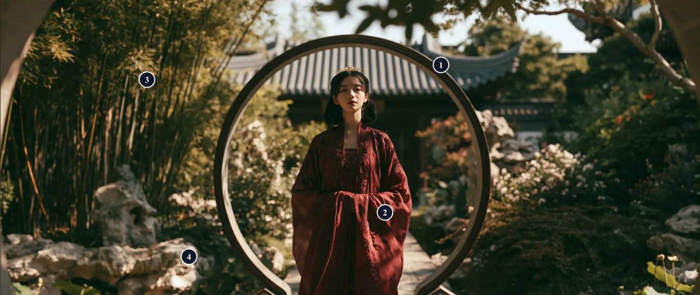

# 生成式视觉模型的技术路线与控制边界

**面向新手的结构化图像与视频提示词 Skill 设计**

课程论文稿 · 资料核查截至 2026 年 11 月 9 日

## 摘要

本文综合模型技术报告、官方产品文档、公开评测和课程原稿，考察 GPT Image、Nano Banana、Seedream、Seedance 与 Midjourney 的架构披露和创作控制。以 Midjourney 与即梦为比较对象，本文将构图、布光和色彩转换为可量化的观察维度，并用两张原稿附件演示复算。针对属性错配、编辑漂移及跨帧失稳，本文将原稿的五类视觉字段和视频分镜经验封装为 Visual Prompt Studio Skill，支持短输入写提示词及参考图反向解析。六个回溯案例中，结构化稿保留了预列的 48 项要点，非空白字符相对原稿减少 81.4%。此结果描述人工文本整理。成片质量、真实 Token 成本和新手用时仍需受控实验检验。文章还讨论了参考素材授权、刻板印象及生成内容标识。

**关键词**　潜空间扩散 · 自回归图像生成 · 音视频联合生成 · 提示词 · 意图保真

## 1. 研究对象与证据口径

本文回答三个问题。第一，公开架构如何解释视觉模型的控制方式，Midjourney 与即梦的风格差异怎样观察和测量？第二，哪些提示信息有助于控制图像与视频，模型在哪些地方仍容易失配？第三，能否把摄影术语和分镜经验封装成初学者只需一句话就能使用的工作流？

原稿提供了主体与置景、美学调性、摄影与构图、光影、后期质感的五类字段，还有四季废墟、武士遮挡转场等案例。本文把这些内容作为创作经验和案例材料。“固定搭配焦距与光圈”“英文提示更好”等原稿判断作为待检验假设。资料中的器材名、截图和提示词只能说明视觉参考，单凭成片无法鉴定模型、镜头或渲染器。[原始案例与术语表](../AI%20Tech%20-%20Video%20Structure.md)

本文区分**平台入口、模型版本与任务模态**。Midjourney 官方版本页列出的默认图片模型是其原生 V8.2，所查官方版本目录未列 GPT Image、Nano Banana 或 Seedance。使用聚合站的作品需另记站点和实际模型 ID。即梦用于静态图像的相关模型线是 Seedream。Seedance 用于视频生成，静态图可以作为视频条件。字节跳动确认 Seedream 5.0 Pro 在国内即梦对应「图片 5.0 Pro」，并公开了 Seedance 2.5 的即梦发布及海外 Dreamina 入口。Seedream 5.5 的发布与账号端实际可选版本分开记录。[14, 23, 25–26]

架构以该版本的技术报告、系统卡或模型卡为依据，产品功能以官方文档为依据，性能数字保留原评测的任务、版本和评分口径。公开研究用来解释可验证的通用机制。附件用于演示观察与复算，在缺少可靠生成记录时将来源标为未知。原稿里“固定机位”“无字幕”等祈使句仅在对应案例中作为生成要求处理。

| 研究对象 | 产品能力 | 有公开依据的架构线索 | 证据边界 |
| --- | --- | --- | --- |
| GPT Image 2 / 2.6 | 静态图像生成和编辑。2.6 另有标注编辑、GIF 等入口能力 | OpenAI 明确将较早的 GPT-4o 原生图像生成描述为自回归，并将 DALL·E 的扩散路线与之区分 | 所查 2.0 / 2.6 系统卡及 API 文档披露产品能力与部分训练信息，无法据此确定当前图像生成主干、视觉编码或采样细节。[1–4] |
| Nano Banana 2.1 | 文图输入，图像和文字输出，多轮编辑和多参考 | 模型卡确认基于 Gemini 3.6 Flash，后者的模型卡再追溯到 Gemini 3.5 Flash。初代 Nano Banana 是 Gemini 2.5 Flash Image，Nano Banana 2 是 Gemini 3.1 Flash Image | 可确认基础模型谱系和模态接口。模型卡未展开专用图像生成模块、视觉码本或采样流程。[5–6] |
| Seedream 2.0 / 3.0 / 4.0 / 5.x | 字节跳动的静态图像线，支持文本出图和图像编辑 | 2.0 披露扩散路线、双语编码与字形条件。4.0 技术报告确认高压缩 VAE、DiT、文生图和编辑的联合训练 | 5.0 Pro 与 5.5 的官方资料可用来确认公开展示的能力。当前版本的 VAE 压缩率、主干和采样细节以各自披露为限。[7–9, 22, 26] |
| Seedance 1.0 / 1.5 Pro / 2.0 / 2.5 | 字节跳动的视频线，支持文生视频、图生视频及较新版本的多模态参考 | 1.0 公开扩散视频系统，1.5 Pro 公开双分支音视频 DiT，2.0 确认统一多模态音视频联合生成，2.5 官方说明延续该框架 | 1.5 Pro 适合解释音视频交互的具体机制。2.x 以各自披露为限。即梦是使用入口，单次生成时长等须按入口核对。[10–14] |
| Midjourney V8.2 | Midjourney 官方默认静态模型，提供审美强度、风格参考、个性化和编辑控制 | 官方公布可操作的模式及效果，版本说明聚焦美学、画质和个性化 | 本文所查资料未给出可确认 V8.2 生成主干、训练目标或采样过程的技术报告。[23–24] |

## 2. 底层原理

### 2.1 提示词作为条件

把图像生成抽象成在条件 $c$ 下从分布 $p_\theta(x\mid c)$ 取样。$x$ 是结果，$c$ 可以包含文本向量、参考图特征和控制信息。输入“电影感”时，符合描述的画面仍有许多种。补充“人物居中被圆门环绕，左上方斑驳日光，深绿背景衬绯红长袍”缩小了合理解的范围，还给了人可以验收的目标。相同条件仍可对应不同构图，约束也可能相互竞争。[15–18]

以公开潜空间扩散为例，训练时用编码器把图片压缩成潜变量 $z_0$，再按噪声计划构造 $z_t=\sqrt{\bar\alpha_t}z_0+\sqrt{1-\bar\alpha_t}\epsilon$。这里 $\bar\alpha_t=\prod_{s=1}^t(1-\beta_s)$ 是累计信号保留系数，$\beta_s$ 控制每一步的加噪幅度，$\epsilon\sim\mathcal N(0,I)$。一种训练目标是最小化真实噪声与预测噪声的均方误差 $\mathbb E\|\epsilon-\epsilon_\theta(z_t,t,c)\|_2^2$。推理从随机噪声开始，多次更新潜变量，再解码为像素。Rombach 等的 U-Net 用交叉注意力融合图文。把潜图位置表示投影为查询 $Q$，文本表示投影为键 $K$ 和值 $V$，计算 $\operatorname{softmax}(QK^\top/\sqrt{d_k})V$。每个位置按相关性汇入文本信息，颜色与物体的绑定还要看训练和采样结果。[15, 19, 31]

### 2.2 DiT、流匹配与自回归是不同层面的设计

| 设计层面 | 公开例子 | 工作机制 |
| --- | --- | --- |
| 压缩表示 | Latent Diffusion | 用编码器获得较低分辨率的潜变量，再在潜空间执行条件生成，最后解码。[15] |
| 生成网络 | DiT、SD3 的 MMDiT | DiT 把潜变量切成块，用 Transformer 处理图像块序列。SD3 对文本和图像用分开的权重并让两模态双向交换信息。DiT 指主干选择。[16–17] |
| 生成轨迹 | 扩散与 Rectified Flow | 扩散模型学习从不同噪声强度恢复信号。以直线插值 $z_t=(1-t)z_{\mathrm{data}}+t\epsilon$ 为例，训练目标速度为 $\epsilon-z_{\mathrm{data}}$，推理用网络估计 $v_\theta$，从 $t=1$ 到 $t=0$ 求解 $\mathrm dz/\mathrm dt=v_\theta(z_t,t,c)$。Transformer 可以作为速度估计的主干。[15–17] |
| 序列生成 | Parti | 将图像编码为离散视觉 Token，再用 $p(v_{1:n}\mid c)=\prod_i p(v_i\mid v_{<i},c)$ 描述逐个预测的条件概率，最后解码视觉码。可以类比翻译，输出词表由文字变为视觉码。[18] |

~~~mermaid
flowchart LR
    C["文本与参考 → 条件表示"]
    N["随机噪声"] --> D["潜空间去噪或速度场积分"]
    C --> D
    D --> Z["图像潜变量 → 解码"]
    C --> A["按序预测视觉 Token"]
    A --> V["视觉码序列 → 解码"]
    Z --> O["静态图像"]
    V --> O
~~~

*图 1　两条公开图像生成路线的简图。上方参考潜空间扩散与流匹配，下方参考 Parti。图中路径用于讲解原理。*

可用的产品控制还取决于训练数据和后训练。Seedream 2.0 的双语文本编码器让中文语义直接进入条件，字形对齐 ByT5 处理指定文字的字符线索。Seedream 3.0 通过混合分辨率训练、跨模态旋转位置编码、表示对齐等方法改善生成，并以审美描述和基于视觉语言模型的奖励优化结果。清晰的中文提示与指定字形能提供条件，最终文字仍需逐字检查。[7–8]

Seedream 4.0 给出了从理解到成图的公开例子。微调后的视觉语言模型可理解文本和参考并扩写条件，高压缩 VAE 将图像压成更少的潜变量，高效 DiT 在该表示上生成。文生图与编辑共同参与后训练，使“从头画一间房”与“保留房间布局，仅替换沙发”可以共享生成框架。技术报告 v3 的摘要给出单张 2K 图像约 1.4 秒，测试口径排除了语言或视觉语言提示增强器。平台实际等待还会受到提示处理、排队与传输影响。[22]

### 2.3 视频多出时间与声音两个控制问题

视频同时要求单帧看起来合理、相邻帧运动连贯、不同镜头里的主体身份持续一致。以朴素全注意力为例，若一个空间切片有 $N$ 个潜变量块，时间上有 $F$ 个切片，直接对 $FN$ 个块算两两关系的量级为 $(FN)^2$。假设 $N=256$、$F=16$，就有约 1,678 万对关系，每个注意力头均需处理。实际架构可以采用时空压缩、分解注意力或其他方法降本。压缩和分解也带来取舍，例如短时遮挡后仍需恢复同一件披风、不同尺度动作仍需协调。这一计算是机制示例。[10–12, 16]

Seedance 1.0 的技术报告公开了一种降本结构。因果时空 VAE 在时间维下采样 4 倍，在宽、高各下采样 16 倍，潜变量有 48 个通道。扩散 Transformer 把帧内空间层和跨帧时间层分开，时间层使用窗口注意力，文本只在空间层参与图文交互。多镜头位置编码提供镜头和时空顺序。训练用包含动作、镜头和主体关系的视频描述，并对运动、画质和遵循反馈作优化。部署侧通过蒸馏及系统优化加速。厂商披露在 NVIDIA L20 上生成 5 秒 1080p 片段耗时 41.4 秒，约为播放时长的 8.3 倍，描述的是当时的测试配置。[10–11]

Seedance 1.5 Pro 披露双分支扩散 Transformer 和跨模态联合模块。可将它理解为音频和视频分别表示，各自处理时间结构，并交换与对方相关的信息。例如，马蹄触地的视觉事件与音频中的碰撞声应发生在同一时间附近。Seedance 2.0 报告确认统一音视频联合架构与四模态参考能力。2.5 发布说明确认沿用这一框架，单次生成延长至最长 30 秒。技术公开程度不足以推导 2.5 内部的每层结构。[12–14]

### 2.4 质感为何随着技术演进改变

本文将质感拆为局部材料、明暗过渡、整体空间和时间一致性。人像中，毛孔、雀斑、织物经纬和皮肤亮斑的分布影响是否显得过度磨皮或油亮。场景中，遮挡顺序、光源方向和投影一致性影响物体是否像处在同一个空间。视频还要看这些结构能否在运动和遮挡前后保持。几个技术阶段解决了不同问题，也可能在同一系统中并存。

| 代表路线 | 结构或训练变化 | 成片中可以观察什么 |
| --- | --- | --- |
| GAN 与 StyleGAN2（2014–2020） | 生成器 $G$ 学习让判别器 $D$ 把样本判为真实。原始目标为 $\min_G\max_D [\mathbb E_x\log D(x)+\mathbb E_z\log(1-D(G(z)))]$。StyleGAN2 改动归一化以处理旧架构的水滴状伪影。[32–33] | 检查规则形状的重复伪影与纹理是否贴合表面。高质量人脸合成和可控的复杂文本构图属于不同任务。 |
| 像素扩散与潜空间扩散（2020–2022） | DDPM 逐步去噪。潜空间路线把多步计算移入较小的表示，并接入文本或布局条件。[15, 31] | 取样多次可观察构图与材质的多样性。压缩或解码可能影响微小字形和高频细节，需分别看原生输出、放大和导出。 |
| 自回归视觉码与 DiT（2021–2024） | VQGAN 类方法学习离散视觉码，Transformer 可逐个输出视觉码。DiT 则用 Transformer 建模潜变量块之间的关系，公开的 MMDiT 还能联合建模图文。二者的采样目标不同。[16–18, 34] | 比较全局布局、主体和颜色的绑定、以及局部细节。自回归方法的表现受视觉码本和解码器影响，DiT 的表现也随训练预算、表示和采样设置变化。 |
| 多参考、编辑与偏好训练（2023–2026） | 更细的图文说明给材质、动作和光照提供监督。偏好训练改变模型更容易给出的画面。联合编辑训练和参考条件使局部修订与角色一致性可作为独立目标。[5, 17, 21–22, 26, 29] | 检查背景保留、发丝和织物细节、反射一致性及文字正确性。锐度、风格强度、指令遵循和参考保真可分别变化。 |
| 时空和音视频联合生成 | 视频模型压缩时空表示并学习跨帧关系，部分系统还联合建模声画，允许图、视频和声音分别承担参考职责。[10–14] | 同样的单帧质感下，继续检查手与道具接触、遮挡后角色是否复现、动作与声源是否同步。 |

**同一任务上的量化例子。** Dhariwal 和 Nichol 的表 4 对 ImageNet 256×256 比较了 BigGAN-deep 与带分类器引导的扩散 ADM-G，FID 从 6.95 降至 4.59，召回指标从 0.28 升至 0.52，精确指标从 0.87 降至 0.82。同表无引导 ADM 的 FID 为 10.94。FID 是生成样本与真实样本的特征分布距离，数值受样本集及预处理影响。这里展示了引导、架构与采样条件的共同作用，三个指标也呈现了画面保真与分布覆盖之间的取舍。[35–36]

**总体进步和单项失配可以同时出现。** Esser 等的 GenEval 表 5 给出 SD v1.5 综合 0.43、位置 0.04、颜色归属 0.06，SDXL 分别为 0.55、0.15、0.23，DALL·E 3 为 0.67、0.43、0.45。同表作者的 1024×1024、深度 38、经 DPO 优化的模型为 0.74、0.33、0.60。总体与颜色归属分更高，位置分低于 DALL·E 3。这些是特定基准上的版本差异，无法隔离主干、训练数据和后训练的独立效果。[17, 19]

## 3. 目前能做到什么程度

| 证据 | 评估口径与结果 | 对创作的含义 |
| --- | --- | --- |
| GPT Image 2.6 发布和 API 文档 | Flare 在低质量设置下，官方称最快约 6 秒。2.6 API 的复杂度控制与渲染质量是两项设置。发布材料展示图像编辑中保持主体细节的用法。[2–4] | 可将快速预览、复杂布局和定稿渲染分开设置。最快耗时属于厂商示例，首轮验收率和平均等待时间需单独测量。 |
| Nano Banana 2.1 模型卡，2026 年 10 月 | 文生图总体偏好 Elo，Thinking 1050±14，No Thinking 1015±13。信息图事实性自动评测为 0.521 与 0.328，差 0.193 分。多人物一致性编辑 Elo 为 1106±14 与 1068±14。[5] | 该模型的思考设置在厂商指定任务中与更好表现同时出现。Elo 衡量相对偏好。信息图事实性来自自动评分，不能直接作为每张图或每条文字的正确率。 |
| Seedream 5.0 Pro 与 5.5 厂商资料 | 5.0 Pro 展示圈选、草图引导和图层编辑。5.5 新增原生 RGBA 输出。MagicArena 图生图写实对照报告相对 5.0 Pro 的 GSB 为 +55.62%，其密集文字等中英文任务报告严重与轻微坏字率分别为 0.4% 和 1.7%。[9, 26] | GSB 来自专家对成对样本标注优、平、劣，和正确率是不同口径。连续编辑 100 轮是厂商演示。应在自己的参考上核对指定区域外的像素变化及多轮累积漂移。 |
| SeedVideoBench 2.0，表 1 与表 2 | 文生视频 1–5 分。Seedance 1.5 到 2.0，运动质量 2.39→3.75，视频指令遵循 2.59→3.43，音画同步 2.91→3.75。2.0 的视频指令遵循可用率（≥3 分）84.97%，满意率（≥4 分）51.23%。[13] | 同一测试里，满足较高要求的比例明显低于基本可用率。视频运动自然与剧情或镜头逐项正确可分别评分。 |
| SeedVideoBench 2.0，表 24 | 参考生视频，Seedance 2.0 的参考对齐为 3.03/5，动作质量 3.24/5，指令遵循 2.52/3。此处各列量表不同。[13] | 素材确实提供了条件。角色与运动同时绑定仍可能出现局部漂移。 |
| Seedance 2.5 官方能力 | 发布资料给出单次最长 30 秒，支持多轮延长，并强化多模态引用和按时间定位编辑。[14] | 可以尝试原稿的 30 秒长镜。实际能否按指定秒数完成四场转场，需要以成片逐段检查。 |

以文生视频遵循指标为例，2.0 的可用率相对 1.5 从 54.29% 到 84.97%，提高 **30.68 个百分点**。同一 2.0 组从基本可用到满意的差为 **33.74 个百分点**，即这部分样本在该维度恰好得 3 分，受四舍五入影响。表 1–2 是厂商报告所选模型和提示集合上的结果，和 Nano Banana 的 Elo 或事实性得分不能合成排行榜。[5, 13]

### 3.1 失配的类型与处理边界

| 失配 | 可观察现象 | 结构化方法能做的事 | 仍需验证或制作的环节 |
| --- | --- | --- | --- |
| 主体与属性错配 | 数量正确但红色给了错误物体，画面左右颠倒 | 每个主体单独写身份、位置、属性，必要时提供布局参考 | 按主体逐项检查，局部编辑，保留已正确区域。[5, 19–20] |
| 文字和事实错误 | 小字模糊、字形变形、图表把事实关系画错 | 指定逐字文字与位置，给排版留空间，图表数据另存 | 逐字和逐数核对，复杂文字交给排版工具。[4–5] |
| 参考编辑漂移 | 更换背景时人脸、姿态或标识变动 | 指定一个改动范围，列出必须保留的区域，参考按作用编号 | 比对同一素材前后，必要时用平台支持的遮罩或进行合成。[4–5] |
| 跨帧一致性和物理 | 遮挡后角色换脸，马蹄滑动，手与武器穿插 | 固定角色锚点，分开描述主体与相机运动，每段优先一个主动作 | 逐帧核对遮挡和接触。需要更确定的动作与身份时可用实拍、动画或分段制作。历史 VideoPhy 人评中，参评模型里联合满足提示与物理常识比例最高的 CogVideoX-5B 为 39.6%。[12–14, 37] |
| 时间与音画同步 | 台词错位、风雪提前出现、无配乐被误读为全静音 | 绑定事件、时间窗和声源，将对白、环境声、配乐分别处理 | 测量实际时间边界与声音偏移，必要时后期剪辑和配音。[12–14] |

### 3.2 Midjourney 与即梦的风格控制

| 可比较的控制方式 | Midjourney 原生 V8.2 | 即梦相关的 Seedream 图像工作流 |
| --- | --- | --- |
| 默认审美 | Standard 会加入平台的默认审美。Raw 减弱这层自动风格化，Stylize 调节审美介入程度，官方范围 0–1000，默认 100。个性化档案会进一步改变结果。[23–24] | 可用自然语言明确媒介、构图、布光和材质，也可用图文输入限定构图和外观。记录入口是否自动扩写、所用模型和参考功能，才能判断结果差异。[9, 22, 25–26] |
| 风格参考 | Style Reference 单独承担色彩、媒介、纹理或布光参考。参考强度和个人档案会影响结果。[24] | 用具体指令区分参考职责，例如“图 1 只定人物造型，图 2 只借暗青与琥珀配色”。改图还可按入口支持的方式标注目标区域。[9, 25–26] |
| 海报与指定文字 | 官方建议用双引号标出文案，短拉丁字母文本更容易控制。可用 Raw 或降低 Stylize 重试。[24] | Seedream 的公开研究涉及双语编码、字形条件，5.0 Pro 演示包含高密度文字版面。成品用逐字比对和位置核验。[7, 9] |

这里能确认的是控制方式的差异。“Midjourney 更偏概念艺术，即梦更偏写实”可拆成待检验的假设。例如，在同一条弱风格提示下，观察两组是否有不同的轮廓光频率、饱和度或主体占比。任务、参考、入口默认参数、个性化以及挑图习惯都可能改变差异方向。

### 3.3 公开评测中的历史对照

Z-Image 技术报告表 11 在同一 TIIF-Bench testmini 口径下列出 Midjourney V7 与 Seedream 3.0。TIIF 的短版与长版设计上保留相同语义，长版加入语言展开。风格项衡量输出是否符合**指定风格**，文字项衡量图中文字的还原。表中数值沿用论文的百分制，差值为 Seedream 减 Midjourney。[27–28]

| 指标 | Midjourney V7 短 / 长 | Seedream 3.0 短 / 长 | 短版差值 | 长版差值 |
| --- | ---: | ---: | ---: | ---: |
| 综合指令遵循 | 68.74 / 65.69 | 86.02 / 84.31 | +17.28 | +18.62 |
| 指定风格遵循 | 83.33 / 80.00 | 100.00 / 93.33 | +16.67 | +13.33 |
| 图中文字还原 | 24.83 / 20.83 | 97.17 / 87.78 | +72.34 | +66.95 |

两者在这批任务上的风格差距小于文字还原差距。长版综合得分分别低 3.05 和 1.71 分，为“语义已经充分时，单纯扩写未必有帮助”提供了对照证据。该表的风格分描述指定风格的遵循程度，无法据此判定哪组图更饱和、构图更夸张或更受欢迎。ViPO 的构图子集也采用过 Midjourney V7 原图与 Seedream 3.0 同文本生成配对，构图偏好由三个视觉语言模型投票。原有 Midjourney 素材的风格参考设置可能带来额外条件。上述历史资料适合说明对照方法和能力差异，V8.2 与即梦现用版本的视觉分布仍需新样本验证。[27–29]

Seedream 3.0 报告另做过更直接的人像对照。100 条人像提示涵盖表情、姿态、毛发和皮肤，经过超过 50,000 轮公开成对投票，Seedream 3.0 和 Midjourney V6.1 同列第一。报告作者将 Seedream 3.0 的强项描述为皱纹、细毛和疤痕等微纹理，将 Midjourney V6.1 的强项描述为表情传达。可以分别以可辨毛孔或细毛比例、肤质过度平滑发生率、表情意图符合率复测。研究为 Midjourney 多轮抽取以筛掉偏抽象的结果，结果适用于该人像任务和采样流程。[8]

### 3.4 把视觉差异转成可复算的指标

| 原稿术语 | 可记录的数据 | 如何解释 |
| --- | --- | --- |
| 框中框、三分构图、负空间 | 主体包围框中心横坐标除以画宽，主体包围框面积除以全画面面积，标注是否由门洞或枝叶形成框景 | 画面居中时横坐标接近 0.50，左三分线接近 0.33。负空间另外按区域标注，避免把所有非主体区域都算为留白。 |
| 低调布光、明暗反差、柔和高光 | 亮度代理值的中位数 P50 与跨度 P90−P10。对高光是否柔和单独盲评 | P50 较低表示全图大部分区域偏暗。跨度较大表示像素分布中的亮部和暗部更分离。实际布光还需观察主体和光源位置。 |
| 低饱和、冷暖对照、暖色点光 | 全图平均 HSV 饱和度。用同一色相阈值在亮度与饱和度足够的区域统计冷暖点色占比 | 结合天空、皮肤、道具的区域标注解读。暖色点光可能只占很少像素。 |
| 浅景深、前景柔化、材质颗粒 | 标注近、中、远三个区域分别是否清晰，按 0–2 档记录。另标注皮革、毛发等目标材质是否可辨 | 明确描述焦点与虚化顺序。用成片观感验收，焦距、光圈与真实胶片由独立资料确认。 |

下表用原稿的两张素材演示指标。脚本按原文件尺寸读取 RGB，每像素用 0.2126R′ + 0.7152G′ + 0.0722B′ 得到 0–1 的显示编码亮度代理值。HSV 饱和度为最大与最小通道之差除以最大通道值，黑色记为 0。结果属于全图统计，受裁切、材质和内容本身影响。[复算画面指标](实验/复算画面指标.py)

| 原稿参考 | 像素尺寸 | 实际画幅 | 亮度 P50 | 亮度 P90−P10 | 平均 HSV 饱和度 |
| --- | ---: | ---: | ---: | ---: | ---: |
| [月洞门](../图片和附件/image%2011.png) | 1371 × 579 | 2.368:1 | 0.179 | 0.515 | 0.454 |
| [薰衣草田](../图片和附件/image%2034.png) | 899 × 485 | 1.854:1 | 0.155 | 0.703 | 0.344 |

*图 2　原稿的薰衣草田参考。左侧为暖金高光，远处是成片暗色树林，近景柔焦的花穗占据画面下部。*

薰衣草田图的亮度中位数较低，亮暗跨度高 0.188。画面中大面积暗色树林与左侧高亮天光能解释这组读数。它的平均饱和度低 0.110，局部金色逆光仍很醒目。文件画幅 1.854:1 与原稿提示的 2.39:1 也有差距，说明应分别记录描述目标、入口设置与导出文件。两张附件的生成平台及版本无法确认，统计用于演示分析方法。

实测两端默认风格时，用相同场景与同语义提示，固定共同支持的画幅，分别采集 Midjourney V8.2 Standard、V8.2 Raw 与即梦「图片 5.0 Pro」或账号实际提供的固定版本。Midjourney 关闭个性化和风格参考，记录 Stylize。即梦记录可见的提示优化设置。可用月洞门人像、薰衣草田远景、带逐字标题的海报三项任务，分别跑弱风格与明确风格两种提示，每个条件采三次并按固定顺序取首张，共 54 张。预先标注主体和皮肤区域，分开报告同任务内的主体位置、肤质可辨比例、饱和度、亮度跨度、指定风格符合率和文字还原率。盲评时同时报告评分员一致程度。相同的随机种子数字无法保证两个平台取到同一随机样本。该设计用任务与条件配对比较。

## 4. 提示词写到什么程度

### 4.1 公开实验证据

**详细的语义描述可以有帮助。** OpenAI 的 DALL·E 3 论文把训练时的描述质量和推理时的描述扩写分别研究。表 1 中，GPT-V 评估 DALL·E 3 的 DrawBench short 为 70.4%，long 为 81.0%。论文第 4.1.2 节使用 GPT-4 扩写描述，长短条件伴随信息内容与评判描述的差异。该结果支持研究可视细节与扩写流程，对今天的模型只提供历史证据，无法隔离字符数本身的作用。[21]

**复杂度比字数更能说明任务为何变难。** GenEval 在 553 条提示上按物体共现、位置、数量和颜色等条件评估，每条提示生成 4 张图。它揭示整体观感和具体属性绑定可以分开测。Jaiswal 等在 ConceptMix 中比较同一生成调用预算下的并行重抽与反馈驱动迭代。以下为该文表 1 的全条件通过率。闭源模型在减少后的提示子集上测试，ConceptMix 的预算 $B=12$，评分由多模态模型完成。[19–20]

| 论文使用的版本 | $k=1$ 并行 | $k=7$ 并行 | $k=7$ 迭代加并行 | $k=7$ 差值 |
| --- | ---: | ---: | ---: | ---: |
| GPT-Image-1 | 94.2% | 51.3% | 61.9% | +10.6 个百分点 |
| Gemini 2.5 Flash Image | 93.8% | 55.4% | 63.7% | +8.3 个百分点 |

这里的 $k$ 是组合概念数。一个提示即使很短，也可能要求模型同时满足数量、位置、颜色和遮挡等多个条件。迭代组用前一次成片和反馈逐项纠正，能解释为什么“只改一处，再核对”值得纳入 Skill。它与本文的文本压缩是不同干预，数值不用于估计 Skill 的收益。[20]

### 4.2 将“电影感”改写成验收条件

| 任务 | 足够开始的信息 | 出现偏差时增加的信息 |
| --- | --- | --- |
| 静态氛围图 | 主体、场景、一个构图目标、一个主要光源或色调 | 哪边受光、背景清晰到什么程度、哪个材质需要读得出来 |
| 海报和商品图 | 主体身份和数量、文字原文、版面位置、比例 | 指定净空、视觉层级、保持外观的参考图或后期排版 |
| 单镜短视频 | 主体、环境、一个主动作、镜头是否移动、结束状态 | 主体与镜头各自方向、接触细节、声源和触发时刻 |
| 多阶段叙事 | 全片不变量、按顺序的时间段、参考职责和转场触发 | 只在验收需要时细化精确节奏、对口型、段尾段首对齐 |

“85 mm、f/2.8”可作风格线索。画面效果仍受画幅、机位、拍摄距离和对焦位置影响。在提示中写“头肩特写，对焦双眼，远处灯点柔化成圆斑”，用户能直接验收。原稿外星战士案例的“f/28 大光圈”可能有小数点遗漏，本文保留可见的浅景深目标。原稿对 2.35:1 等比例的偏好可以转成设置或安全裁切需求。英文术语可按需保留，默认使用用户熟悉的语言。要比较中英文，应固定版本与设置，用语义等价的提示做配对测试。[4, 6–8]

原稿关于风、发丝、衣料和模糊位置的例子可以落到一段图像提示。**海边人物正在转身，风从画面右侧吹来，几缕碎发掠过脸颊。双眼清晰，象牙白外衣掠过画面下缘，只有衣摆边缘轻微运动模糊。** 写成视频时，再增加开始姿态、转身方向和结束状态。例如“单镜固定机位，人物背向镜头站定，随后朝画面左侧转到侧脸，碎发随风朝左，最后停在侧脸”。开始时只放能验收的约束，文字、手与物体接触、转场或音画同步是任务关键时，再增加对应条件。本文的图片、视频结构化稿平均约 100 和 163 个非空白字符，属于六个案例的编辑预算。短句多少字合适取决于所需关系与事件。

## 5. 个人方法与 Skill 实现

方法的输入可以是“古风庭院里的红衣女子，站在圆门中间，有电影感”。先提取用户明确指定的庭院、红衣、女子、圆门中央，再调用构图、光影或材质词库，将“电影感”具体化。若用户上传参考，可据此识别竹林、假山、斑驳日光。若只有短句，则这些都是可以调整的创作选择。Skill 优先保护明示要求，将参考可见信息与创作默认分别处理。

~~~mermaid
flowchart LR
    A["一句简述或参考素材"] --> B["提取主体、关系、时间和不可改项"]
    B --> C["按需查询视觉术语或视频时序"]
    C --> D["将术语写成可观察条件"]
    D --> E["压缩提示词并核对硬约束"]
    E --> F["成片逐项检查"]
    F -- "发现偏差" --> G["只修订相关字段"]
    G --> E
~~~

*图 3　从用户简述到可复制提示词，再到按失配项修订。*

- **提示生成。** 图片用主体与置景、媒介、构图与焦点、色彩光影、必要质感。用户已有具体描述时直接整理。改图使用目标区域、变化、保留项。
- **视频时序。** 先锁住人物外观与运动方向，再描述开始、变化、结束。复杂事件加时间窗和转场触发。主体向右和镜头向右分别写。全片为一镜时，时间窗指镜头内的事件。
- **反向解析。** 从参考图标出主体、空间关系、光影、色彩与纹理，把判断和未知项另列。可交付一段复现提示词，或在副本上放编号并附图例。Midjourney 的 Describe 是已有的图生提示入口，默认给四个建议。本文的工作流增加可定位的观察依据、可复制的跨平台提示和未知项记录。[38] [反向解析说明](visual-prompt-studio/references/reverse-analysis.md)
- **按需查词。** 入口只保存决策规则，视觉词库把“孤独”关联到负空间和小尺度主体，时序词库区分横摇、横移、推进、变焦等可观察变化。指定平台时才查平台差异。词库和风格解释留在工作流里，输出保留与结果相关的短句。
- **新手接口。** 可以直接在本项目说“用课程论文里的 Visual Prompt Studio 写提示词。视频，雨夜骑士往右走，镜头跟着他，无对白。”默认收到一段可复制提示词。需要上传参考、改设规格或确认明显影响画面的默认时另行说明。移植时保留完整技能目录及其相对路径。[Skill 入口](visual-prompt-studio/SKILL.md)
- **同一语义适配两个入口。** 例如用户说“即梦或 Midjourney，雨夜小巷里一个人撑红伞，像电影”。先写“雨夜窄巷，一个撑红伞的人位于右侧三分线。车灯从侧后方照亮细雨，深青环境衬托红伞，湿石路面只有少量反光。”Midjourney 版将画幅与风格参数放在正文末尾或界面选项。即梦版保留自然语言，在界面选择静态模型和画幅。可分别检验侧逆光、红伞点色、人物位置与湿地反射。[平台适配](visual-prompt-studio/references/platforms.md)

### 5.1 图片案例 I01　用圆门组织画面

*图 4　来自原稿附件 image 11.png，用于观察圆形框景、居中人物和日光层次。*

| 信息来源 | 内容 |
| --- | --- |
| 用户简述 | 古风庭院，红衣女子位于圆门中央 |
| 参考与原稿 | 中远景、圆门框景、竹林假山、斑驳日光、暗绿与暖金 |
| 交付提示 | 写实古装剧情剧照。绯红长袍女子站在圆形月洞门正中，中远景，门洞居中对称框住人物。近处竹叶与假山，门后石径通向灰瓦木构。午后日光穿过树冠，在深绿庭院形成暖金斑驳光，绯红衣袍是主要点色。保留自然阴影与轻微胶片颗粒。 |

首先核对女子、红衣和圆门的位置，再看框景是否确实将注意力引向人物，最后判断光影与材质。原稿中的具体器材估计和较多风格标签可压缩。原稿给出约 2.35:1，若用户将其定为硬约束，应放在平台设置或裁切要求中，并检查裁切后门洞和人物仍完整。

### 5.2 视频案例 V01　用四段天气表现同一世界

*图 5　来自原稿附件 image 32.png。截图可见角色侧向、焦黑建筑和前中后景关系。四季、运动和音轨以原稿描述为依据。*

| 时间 | 主要事件 | 画面检查 |
| --- | --- | --- |
| 0–4 秒 | 春雨打湿焦墙与路面，马蹄踩入水洼 | 马蹄接触后溅水，前景可短暂掠过孩子与狗 |
| 4–8 秒 | 热风卷起灰烬，断墙旁有人搬残木 | 废墟标志延续，骑士与战马同向行进 |
| 8–12 秒 | 枯叶飘落，幸存者蜷在墙下 | 人物变化发生在背景，骑士仍是视觉焦点 |
| 12–15 秒 | 断墙半埋在雪中，骑士进入暴雪 | 镜头继续平移，骑士向右淡出视野 |

全片保持同一骑士和战马的外观，正侧面向右行进，镜头等速并行，无字幕、文字和配乐。时间分配是本文改写时加入的制作选择。截图不能确认原稿里的两份编号素材都已提供，因此复算稿采用文字身份描述。实际有两份设定图时分别绑定骑士、战马。若成片在换季处容易跳切，先移除可选背景事件，保留四季顺序和连续运动。若允许以剪辑实现连贯感，再使用遮挡作段落接点。

### 5.3 从月洞门图反向提取提示词

本例以「拆解这张图，给复现提示词和标注图」为输入。对图 4 重新观察时，以画面可见内容为准。原稿关于镜头、景别、颗粒的文字判断单独保留，图片下缘实际裁到衣袍。

*图 6　同一附件的标注副本。① 圆形门缘形成框中框。② 绯红衣袍是主要点色。③ 左侧竹林建立空间层次。④ 左下石景的亮斑与阴影显示斑驳光。*

| 信息类型 | 本例输出 |
| --- | --- |
| 画面可见 | 绯红衣袍人物正面站在圆门中央，衣袍下缘出画。竹林和山石位于近处，门后有石径与灰瓦屋檐。深绿环境衬托红衣，庭院和衣袍可见暖亮斑。 |
| 风格判断 | 「写实古装剧照感」可用来概括服饰、光影和构图。 |
| 待确认 | 相机、焦距、光圈、实际拍摄或合成流程、生成模型及原始提示词。单帧也不足以确定人物或摄影机的移动方向。 |

**可复制提示词**

> 超宽横幅写实古装剧照。绯红刺绣长袍女子正面立于庭院月洞门中央，圆门形成对称框景，衣袍下缘出画。左侧竹林与近处山石形成前景，门后石径通向较柔的灰瓦屋檐。对焦脸与衣襟，深绿庭院保留暖金色斑驳日光，绯红衣袍是主要点色。

本例标注点依次为 `[[0.63,0.22],[0.55,0.72],[0.21,0.27],[0.27,0.87]]`，以左上为原点，横纵坐标分别除以画宽和画高。用脚本可复现 SVG，图 6 是用于正文的 PNG 预览。编号指向观察依据，创作者可用同一方法为下一张图记录布光和构图目标。[标注脚本](visual-prompt-studio/scripts/annotate-reference.py)

## 6. 文本审计与生成验证设计

### 6.1 已完成的回溯审计

从原稿选取四个图片案例、两个视频案例，每例列出八项可辨认的内容或控制要点。对照人为拟写的简述、原稿、参照原稿整理的结构化稿。每项完整表达记 1，允许等义措辞。原稿为要点来源，覆盖率按定义为满分。表中长度为去除空白后字符数，含标点和英数字。原稿取消 Markdown 字符转义，保留所选提示词正文与原有小标题，排除图片链接和独立标签。压缩率为 $1-L_{\mathrm{结构化}}/L_{\mathrm{原稿}}$。[逐案素材与标注](实验/提示词案例.json) · [复算脚本](实验/复算提示词审计.py)

| 案例 | 简述字符 | 原稿字符 | 结构化字符 | 原稿→结构化缩减 | 简述要点 | 原稿要点 | 结构化要点 |
| --- | ---: | ---: | ---: | ---: | ---: | ---: | ---: |
| I01 月洞门 | 23 | 507 | 105 | 79.3% | 3/8 | 8/8 | 8/8 |
| I02 薰衣草田 | 24 | 510 | 100 | 80.4% | 2/8 | 8/8 | 8/8 |
| I03 猫飞行员 | 20 | 553 | 97 | 82.5% | 3/8 | 8/8 | 8/8 |
| I04 奇幻藏书楼 | 22 | 698 | 96 | 86.2% | 2/8 | 8/8 | 8/8 |
| V01 四季骑士 | 26 | 964 | 163 | 83.1% | 4/8 | 8/8 | 8/8 |
| V02 武士转场 | 25 | 646 | 162 | 74.9% | 2/8 | 8/8 | 8/8 |
| 合计 | **140** | **3,878** | **723** | **81.4%** | **16/48** | **48/48** | **48/48** |

图片结构化稿均值 99.5 字符，视频 162.5 字符。与原长稿相比少 3,155 字符。相对简述，结构化稿多 583 字符，这部分承载从参考和原稿取回的内容。V02 的简述写了向右跟拍，未明确相机是否横移，所以“单一横向跟拍”在简述组没有计分。原稿中不在八项清单里的细节仍可能被舍弃，如 I01 的具体宽高比、V01 的素材编号和部分人物动作。

此处是知道原稿与要点后的编辑审计，标注为人工设定。结果受选例和要点选择影响，不能视为 Skill 只收到简述时能恢复所有用户心中细节，也不能作为成片对照实验的结果。脚本读取原稿的标注行段并复算字符与标注比例，语义覆盖由人工复核。

### 6.2 验证 Skill 能否降低时间与成本

| 比较组 | 输入给同一生成模型的内容 | 要回答的问题 |
| --- | --- | --- |
| A · 用户简述 | 原始一句话 | 初学者直接生成的表现 |
| B · 通用改写 | 让同一文本模型基于相同输入改写，使用与 C 相近的字符预算 | 仅使用通用改写能取得多少收益 |
| C · Skill 改写 | 同一文本模型使用 Skill 改写，记录调用到的参考小节 | 在同等信息和预算下，术语、优先级与时序结构是否增加可控性 |
| D · 人工长稿 | 独立编写的详尽提示，使用同一任务要求与素材 | 结构化短稿能否在更少输入下接近人工长稿 |

可以用四个图片任务分别在 GPT Image、Nano Banana、Seedream 上做对照，两个视频任务在 Seedance 上做对照。每任务每模型四组各三次，合计计划采集 144 张图片与 24 条视频。所有组可用的目标和参考一致。主要比较 B 与 C。另做一次等信息复核，将两组写到相同的语义条件清单，再判断组织结构本身是否有作用。图生视频和文生视频分层。30 秒若在目标入口不可设置，应统一改到支持的时长或换支持该规格的模型版本。

评审前冻结任务卡和硬约束清单，记录请求日期、模型 ID、入口、分辨率、画幅、质量、复杂度或思考设置、参考素材、种子可用性与音轨设置。支持随机种子时按组配对，无法指定时交错生成并记录批次。保留失败样本和服务错误，固定重试上限。将输出打乱、隐去组名，由至少两位评审独立评分。对同一任务的多次采样按任务汇总，报告分子、分母、按任务的差值与区间。六项案例下区间可能很宽。

- **意图与质量。** 按成片中满足的硬约束数除以应满足项数，另记首次全部满足比例。分开报告 1–5 分的美学评价，并提供每档评分示例。视频在每个时间窗检查动作、方向和事件顺序，测量事件实际时点与目标时间偏差，有声音时记录音画偏移。
- **用户时间。** 招募新手，从看到任务卡开始，分别计时首次写完可复制提示词和首次获得达标成片。记录改写次数、发出的澄清轮次、主动操作时间及含生成等待的总时间。轮换方法与任务顺序，降低学习效应。
- **真实成本。** 记录改写模型的输入输出 Token、生成端可得的文本与参考输入用量、图像输出 Token 或视频额度、失败与重试。若某入口只显示点数或收费，单列单位。折成同一货币后比较「改写支出 + 全部生成和重试支出」，再除以达标成片数。对生成 API 和改写模型分别记录用量，避免把不同模型的 Token 直接换算成相同成本。

以公开的 GPT Image 2.6 Flare API 单价举例，未缓存文本输入为每百万 Token 5 美元，图像输出为每百万 Token 30 美元。假设请求少用 100 个未缓存文本 Token，文本输入约少 0.0005 美元。假设少消耗 1,000 个图像输出 Token，图像输出约少 0.03 美元。这两个数量用于演算价格差异，未计入参考图、缓存或改写费用。[30]

以同一计费单位计，人工方案每次生成 100 单位、平均尝试 3 次时，成本为 300。若 Skill 改写花 20 单位并把平均尝试降至 2 次，总成本为 220，节省约 26.7%。若两组都只需一次，Skill 方案的 120 高于人工方案的 100。该情景说明节约取决于生成和重试的节省是否覆盖改写开销。对真实使用还应计入技能入口与所读词库、提示词改写输出、平台可能的扩写及参考素材。只有用量记录能把字符缩减换成可比较的成本。

## 7. 伦理、权利与可追溯性

| 问题 | 研究证据与本项目的处理 |
| --- | --- |
| 训练素材与输出的权利 | Midjourney 的训练内容摘要将超过 10 亿张图片的规模标在所述模型家族层级，并列出公开网页与商业许可等来源类别。汇总披露不能回答某一件作品的授权状态。Carlini 等在特定扩散模型上通过生成与筛查提取了超过 1,000 条训练样本，说明训练记忆可能产生重现风险。该实验没有给出本文所列平台的日常侵权概率。[39–40] |
| 参考图、肖像与声音 | 分别记录谁持有素材、授权用于什么、是否允许再上传和公开。课堂样例优先选自制或许可明确的素材。处理可识别真人与声音时，核对许可与适用例外。中国《民法典》第 1019–1020 条规定肖像权及合理使用情形，第 1023 条将自然人声音保护参照肖像权保护。公开发行和在课堂必要范围内使用已公开肖像应分别判断。[41] |
| 风格模仿与偏见 | 用框景、低调布光、湿地反光等视觉特征表达风格，保留素材许可及创作出处。Bianchi 等的实验发现，职业等普通提示也可触发刻板表现。词库可减少无依据的身份补全。评估可在相同职业任务中比较人物呈现的多样性和是否出现与职业无关的刻板特征，并保留评分依据。[42] |
| 合成标识与真假 | 中国《人工智能生成合成内容标识办法》自 2025 年 9 月 1 日起施行。第十条要求使用网络内容传播服务发布生成合成内容时主动声明并使用标识功能。C2PA 可提供可验证的来源声明及关联信息，单凭凭证无法证实画面事件真实。截图、转码或编辑可能使来源链不完整。课程案例的编号图另存副本，保留源图和来源记录。[43–44] |
| 人类创作与学术诚信 | 提示词、生成结果和人工作出的构图、选片、剪辑及重绘贡献分别登记。美国版权局 2025 年报告指出，依当时普遍可用技术，仅有提示通常不足以建立对输出的作者身份，人类改动和编排按个案评估。该报告用于比较法讨论。课程提交按课程的 AI 使用规则披露协助范围，并将素材示例、公开评测和本项目实测分开标注。[45] |

## 8. 结论

公开研究显示，生成质感同时受图像表示、生成主干、采样、监督数据和后训练影响。人物表情、肤质细节、指定风格与文字还原可以呈现不同的模型优势。Midjourney 与即梦的入口设置也会改变观察结果，当前视觉风格差异需要同条件生成验证。本文的 Skill 将空间关系、时间事件和保留项写成可验收条件，并用月洞门原图验证了反向拆解和编号标注。六个文本回溯案例支持继续研究这一方法，生成质量、实付成本和新手学习收益留待有对照的使用实验。

## 参考文献

1. OpenAI. *Addendum to GPT-4o System Card: Native image generation*. 2025. [系统卡，§2.1](https://cdn.openai.com/11998be9-5319-4302-bfbf-1167e093f1fb/Native_Image_Generation_System_Card.pdf)
2. OpenAI. *System Card: ChatGPT Images 2.0 and Thinking mode*. 2026. [系统卡](https://deploymentsafety.openai.com/chatgpt-images-2-0/chatgpt-images-2-0.pdf)
3. OpenAI. *Introducing Images 2.6* 与 *ChatGPT Images 2.6 System Card*. 2026. [发布说明](https://openai.com/index/introducing-images-2-6/) · [系统卡](https://deploymentsafety.openai.com/chatgpt-images-2-6/image-provenance)
4. OpenAI. *Image generation* 与 *Image prompting*. [API 指南](https://developers.openai.com/api/docs/guides/image-generation) · [提示词指南](https://developers.openai.com/api/docs/guides/image-prompting)
5. Google DeepMind. *Nano Banana 2.1 Model Card*. 2026. [模型卡，架构、评估与局限](https://deepmind.google/models/model-cards/nano-banana-2-1/) · [Gemini 3.6 Flash 模型卡](https://deepmind.google/models/model-cards/gemini-3-6-flash/)
6. Google. *Build with Nano Banana 2* 与 *Gemini API Image Generation*. 2026. [发布说明](https://blog.google/innovation-and-ai/technology/developers-tools/build-with-nano-banana-2/) · [API 指南](https://ai.google.dev/gemini-api/docs/image-generation)
7. Gong L, Hou X, Li F, et al. *Seedream 2.0: A Native Chinese-English Bilingual Image Generation Foundation Model*. 2025. [arXiv:2503.07703](https://arxiv.org/abs/2503.07703)
8. Gao Y, Gong L, Guo Q, et al. *Seedream 3.0 Technical Report*. 2025. [arXiv:2504.11346](https://arxiv.org/abs/2504.11346) · [人像对照 §3.4](https://arxiv.org/html/2504.11346#S3.SS4)
9. ByteDance Seed. *Beyond Generation, It Understands Design | Introducing Seedream 5.0 Pro*. 2026. [发布说明](https://seed.bytedance.com/en/blog/beyond-generation-it-understands-design-introducing-seedream-5-0-pro)
10. Seed Vision Team. *Seedance 1.0: Exploring the Boundaries of Video Generation Models*. 2025. [arXiv:2506.09113](https://arxiv.org/abs/2506.09113)
11. ByteDance Seed. *Tech Report of Seedance 1.0 Is Now Publicly Available*. 2025. [测试硬件和耗时](https://seed.bytedance.com/en/blog/tech-report-of-seedance-1-0-is-now-publicly-available)
12. Team Seedance. *Seedance 1.5 Pro: A Native Audio-Visual Joint Generation Foundation Model*. 2025. [arXiv:2512.13507](https://arxiv.org/abs/2512.13507)
13. Team Seedance, Chen D, Chen L, et al. *Seedance 2.0: Advancing Video Generation for World Complexity*. 2026. [arXiv:2604.14148，表 1、2、24](https://arxiv.org/pdf/2604.14148)
14. ByteDance Seed. *One-take Creation, Flexible Referencing: Introducing Seedance 2.5*. 2026. [国内发布说明](https://seed.bytedance.com/zh/blog/one-take-creation-flexible-referencing-introducing-seedance-2-5) · [海外发布说明](https://seed.bytedance.com/en/blog/one-take-creation-flexible-referencing-introducing-seedance-2-5)
15. Rombach R, Blattmann A, Lorenz D, et al. *High-Resolution Image Synthesis with Latent Diffusion Models*. CVPR, 2022. [arXiv:2112.10752](https://arxiv.org/abs/2112.10752)
16. Peebles W, Xie S. *Scalable Diffusion Models with Transformers*. ICCV, 2023. [arXiv:2212.09748](https://arxiv.org/abs/2212.09748)
17. Esser P, Kulal S, Blattmann A, et al. *Scaling Rectified Flow Transformers for High-Resolution Image Synthesis*. ICML, 2024. [arXiv:2403.03206](https://arxiv.org/abs/2403.03206)
18. Yu J, Xu Y, Koh J Y, et al. *Scaling Autoregressive Models for Content-Rich Text-to-Image Generation*. 2022. [arXiv:2206.10789](https://arxiv.org/abs/2206.10789)
19. Ghosh D, Hajishirzi H, Schmidt L. *GenEval: An Object-Focused Framework for Evaluating Text-to-Image Alignment*. NeurIPS, 2023. [arXiv:2310.11513](https://arxiv.org/abs/2310.11513)
20. Jaiswal S, Prabhudesai M, Bhardwaj N, et al. *Iterative Refinement Improves Compositional Image Generation*. 2026. [arXiv:2601.15286，表 1 与 §4.1](https://arxiv.org/html/2601.15286v1)
21. Betker J, Goh G, Jing L, et al. *Improving Image Generation with Better Captions*. OpenAI, 2023. [原文表 1 与 §4.1.2](https://cdn.openai.com/papers/dall-e-3.pdf)
22. Team Seedream. *Seedream 4.0: Toward Next-generation Multimodal Image Generation*. 2025. [技术报告 v3](https://arxiv.org/abs/2509.20427v3) · [架构与加速说明](https://seed.bytedance.com/en/blog/seedream-4-0-officially-released-beyond-drawing-into-imagination)
23. Midjourney. *Version* 与 *Version 8.2*. 2026. [版本说明](https://docs.midjourney.com/hc/en-us/articles/32199405667853-Version) · [V8.2 发布说明](https://updates.midjourney.com/version-8-2/)
24. Midjourney. 官方控制文档。[Raw](https://docs.midjourney.com/hc/en-us/articles/32634113811853-Raw) · [Stylize](https://docs.midjourney.com/hc/en-us/articles/32196176868109-Stylize) · [Style Reference](https://docs.midjourney.com/hc/en-us/articles/32180011136653-Style-Reference) · [Text Generation](https://docs.midjourney.com/hc/en-us/articles/32502277092109-Text-Generation)
25. ByteDance. *Giving creators more control with Dreamina Seedance 2.5 and Dola Seedream 5.0 Pro*. 2026. [Dreamina 发布说明](https://www.bytedance-global.com/newsroom/dreamina-seedance-2-5-dola-seedream-5) · [国内入口部署说明](https://seed.bytedance.com/zh/blog/beyond-generation-it-understands-design-introducing-seedream-5-0-pro)
26. ByteDance Seed. *More Realistic Images, More Stable Editing Across 100 Rounds | Introducing Seedream 5.5*. 2026-11-09. [发布与评测说明](https://seed.bytedance.com/en/blog/more-realistic-images-more-stable-editing-across-100-rounds-introducing-seedream-5-5) · [能力展示](https://seed.bytedance.com/en/seedream5_5)
27. Team Z-Image. *Z-Image: An Efficient Image Generation Foundation Model with Single-Stream Diffusion Transformer*. 2025. [arXiv:2511.22699v2，表 11](https://arxiv.org/html/2511.22699v2#S5.T11)
28. Wei X, Zhang J, Wang Z, et al. *TIIF-Bench: How Does Your T2I Model Follow Your Instructions?* 2025. [arXiv:2506.02161](https://arxiv.org/abs/2506.02161) · [任务与评分说明](https://a113n-w3i.github.io/TIIF_Bench/)
29. Li M, Wu J, Cui J, et al. *ViPO: Visual Preference Optimization at Scale*. ICLR, 2026. [论文附录 B.1](https://openreview.net/pdf/cc33a36e8a16848dd99f08763eb9d28783c0f5cc.pdf#page=17)
30. OpenAI. *GPT Image 2.6 Flare*. 2026. [模型用量与价格](https://developers.openai.com/api/docs/models/gpt-image-2.6-flare)
31. Ho J, Jain A, Abbeel P. *Denoising Diffusion Probabilistic Models*. NeurIPS, 2020. [arXiv:2006.11239](https://arxiv.org/abs/2006.11239)
32. Goodfellow I, Pouget-Abadie J, Mirza M, et al. *Generative Adversarial Nets*. NeurIPS, 2014. [会议论文](https://papers.nips.cc/paper_files/paper/2014/file/f033ed80deb0234979a61f95710dbe25-Paper.pdf)
33. Karras T, Laine S, Aittala M, et al. *Analyzing and Improving the Image Quality of StyleGAN*. CVPR, 2020. [论文 §2](https://openaccess.thecvf.com/content_CVPR_2020/papers/Karras_Analyzing_and_Improving_the_Image_Quality_of_StyleGAN_CVPR_2020_paper.pdf)
34. Esser P, Rombach R, Ommer B. *Taming Transformers for High-Resolution Image Synthesis*. CVPR, 2021. [会议论文](https://openaccess.thecvf.com/content/CVPR2021/html/Esser_Taming_Transformers_for_High-Resolution_Image_Synthesis_CVPR_2021_paper.html)
35. Dhariwal P, Nichol A. *Diffusion Models Beat GANs on Image Synthesis*. NeurIPS, 2021. [论文表 4 与图 4](https://proceedings.neurips.cc/paper/2021/file/49ad23d1ec9fa4bd8d77d02681df5cfa-Paper.pdf)
36. Heusel M, Ramsauer H, Unterthiner T, et al. *GANs Trained by a Two Time-Scale Update Rule Converge to a Local Nash Equilibrium*. NeurIPS, 2017. [FID 原始定义](https://arxiv.org/abs/1706.08500) · Parmar G, Zhang R, Zhu J Y. *On Aliased Resizing and Surprising Subtleties in GAN Evaluation*. CVPR, 2022. [预处理对 FID 的影响](https://openaccess.thecvf.com/content/CVPR2022/html/Parmar_On_Aliased_Resizing_and_Surprising_Subtleties_in_GAN_Evaluation_CVPR_2022_paper.html)
37. Bansal H, Lin Z, Xie T, et al. *VideoPhy: Evaluating Physical Commonsense for Video Generation*. 2024. [arXiv:2406.03520v2](https://arxiv.org/abs/2406.03520v2)
38. Midjourney. *Describe*. [官方图生提示说明](https://docs.midjourney.com/hc/en-us/articles/32497889043981-Describe)
39. Midjourney. *Public Summary of Training Content*. 2026. [训练内容公开摘要](https://docs.midjourney.com/hc/en-us/articles/48067080311309-Public-Summary-of-Training-Content)
40. Carlini N, Hayes J, Nasr M, et al. *Extracting Training Data from Diffusion Models*. USENIX Security, 2023. [arXiv:2301.13188](https://arxiv.org/abs/2301.13188)
41. 全国人民代表大会. 《中华人民共和国民法典》. 2020. [人格权编第 1019、1020、1023 条](https://www.cac.gov.cn/2020-06/01/c_15925617772683193.htm)
42. Bianchi F, Kalluri P, Durmus E, et al. *Easily Accessible Text-to-Image Generation Amplifies Demographic Stereotypes at Large Scale*. ACM FAccT, 2023. [会议论文](https://doi.org/10.1145/3593013.3594095)
43. 国家互联网信息办公室等. 《人工智能生成合成内容标识办法》. 2025. [第 10、14 条](https://www.cac.gov.cn/2025-03/14/c_1743654684782215.htm)
44. C2PA. *C2PA and Content Credentials Explainer*. [规范说明 2.2](https://spec.c2pa.org/specifications/specifications/2.2/explainer/Explainer.html)
45. U.S. Copyright Office. *Copyright and Artificial Intelligence, Part 2: Copyrightability*. 2025. [报告第 II.D、II.F 节](https://www.copyright.gov/ai/Copyright-and-Artificial-Intelligence-Part-2-Copyrightability-Report.pdf)
